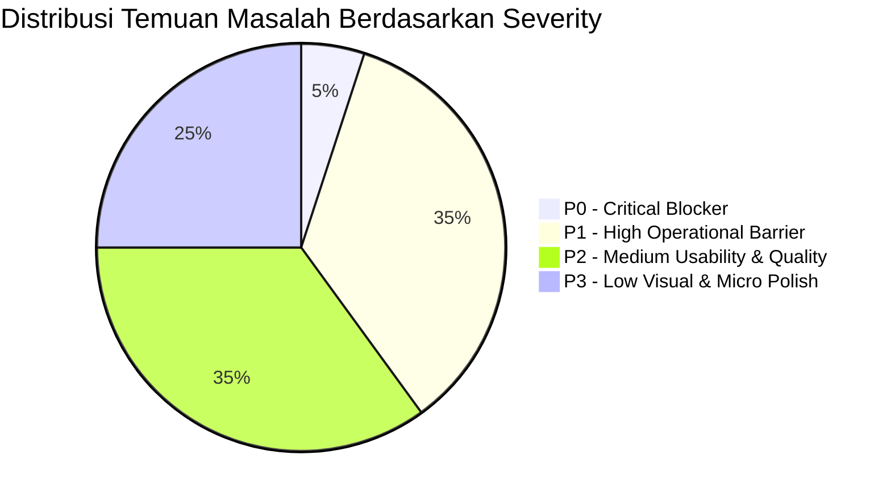
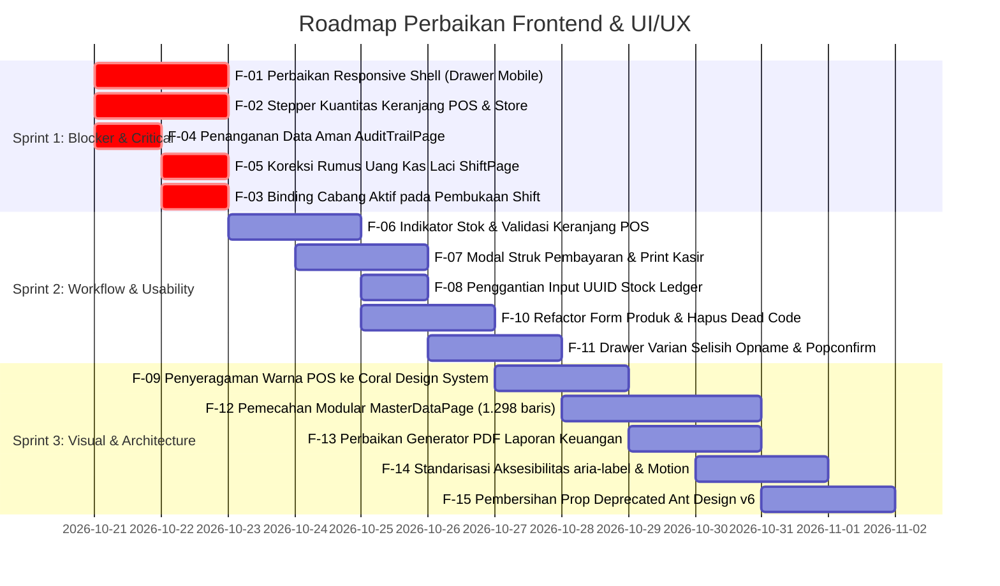

# LAPORAN AUDIT PROFESIONAL UI/UX & FRONTEND
## SISTEM ENTERPRISE INVENTORY, POINT OF SALE (POS) & FINANCE

---

**Tanggal Audit:** 20 Oktober 2026  
**Tim Auditor:** Joint Evaluation Taskforce  
- Senior UI/UX Designer
- Senior Frontend Engineer
- UX Researcher
- Accessibility Engineer
- QA Engineer
- Retail POS Workflow Specialist  

**Scope Evaluasi:** Kode Sumber Frontend (`frontend/src/`), Desain Antarmuka, Pengujian Responsivitas Multi-Viewport, Alur Kasir & Inventaris, Aksesibilitas WCAG 2.2 AA, dan Kualitas Implementasi React 19 / TypeScript / Ant Design.  
**Metodologi:** Pengujian Statis (TypeScript Compiler, Oxlint), Pengujian Otomasi E2E (Playwright Test Suite), Visual Screenshot Automation Multi-Device (Desktop, Tablet, Mobile), serta Evaluasi Interaksi Manual Berbasis Bukti Nyata.

---

## A. EXECUTIVE SUMMARY

Audit komprehensif ini dilakukan terhadap aplikasi frontend **Inventory + Point of Sale (POS)** untuk mengevaluasi kesiapan operasional, konsistensi sistem desain, integritas alur kasir, responsivitas multi-device, aksesibilitas, serta kualitas arsitektur kode frontend.

### 1. Ringkasan Kondisi Frontend
Frontend dibangun di atas tumpukan teknologi modern: **React 19.2.7**, **Vite 8.1.5**, **TypeScript 6.0.2**, **Ant Design 6.5.2**, **Zustand 5.0.14**, dan **TanStack Query 5.101.4**. Arsitektur tata letak mengadopsi konsep *Selective Glass Design System* (KIRO POS) dengan kombinasi panel navigasi mengambang (*floating glass island*) dan area kerja solid (*solid workspace surfaces*).

### 2. Kekuatan Aplikasi (Key Strengths)
- **Kompilasi TypeScript Bersih:** Pemeriksaan tipe (`npx tsc -b`) lulus 100% tanpa kesalahan tipe (*0 type errors*).
- **Kecepatan Build Produksi:** Rollup/Vite bundling berhasil menghasilkan artefak produksi dalam 2.38 detik dengan pembagian *chunk vendor* yang terstruktur.
- **Test Otomasi E2E Berfungsi:** Seluruh 6 skenario Playwright E2E eksisting (`closing.spec.ts`, `pos.spec.ts`, `purchase.spec.ts`) berjalan sukses dalam 13.7 detik.
- **Estetika Desktop Elegan:** Tampilan mode gelap (*dark mode*) pada desktop (1440×900) memiliki kedalaman visual yang kuat dengan aksen warna Vibrant Coral (`#F05328`) dan tipografi *Inter*.
- **Command Palette & Hotkeys:** Integrasi pencarian global (`Ctrl + K` / `⌘ K`) dan shortcut fungsional POS (`F2` bayar, `F3` cari, `F4` scan, `ESC` bersihkan) telah terpasang.

### 3. Risiko & Masalah Kritis Utama (Key Risks)
Meskipun tampilan desktop terlihat menarik, audit berbasis bukti menemukan sejumlah kelemahan kritis yang berisiko fatal pada operasional ritel nyata:
1. **Kegagalan Total Tata Letak Responsif Mobile (`Layout.module.css`):** File CSS tata letak utama tidak memiliki media query sama sekali (`@media` berjumlah 0). Pada layar mobile (390×844) dan tablet (768×1024), sidebar desktop selebar 252px tetap menempel kaku, menekan ruang kerja utama menjadi celah sempit 110px dan membuat seluruh halaman terpotong dan tidak dapat digunakan.
2. **Ketiadaan Kontrol Kuantitas Item di Keranjang Kasir POS:** Kasir **tidak dapat** menambah atau mengurangi kuantitas item secara langsung di keranjang. Kuantitas hanya dirender sebagai teks statis (`2 ×`). Untuk membeli 20 pcs, kasir harus menekan kartu produk 20 kali. Tidak ada tombol minus `-`; pengurangan item mengharuskan kasir menghapus seluruh baris lalu mengulang input dari awal.
3. **Hardcoded Nil UUID pada Pembukaan Shift Kasir:** Fungsi pembukaan shift kasir (`useOpenShift`) mengirimkan string UUID kosong (`'00000000-0000-0000-0000-000000000000'`) untuk `branch_id` dan `warehouse_id`, merusak atribusi cabang dan integritas data multi-lokasi.
4. **Kesalahan Fatal Perhitungan Kas Laci Kasir (*Cash Discrepancy*):** Halaman penutupan shift (`ShiftPage.tsx`) menghitung estimasi kas laci kasir (*Expected Cash in Drawer*) dengan menjumlahkan saldo awal dan **seluruh transaksi selesai**, termasuk transaksi non-tunai (kartu debit/EDC dan transfer bank). Hal ini menyebabkan kasir selalu mengalami selisih fisik kas palsu (*false cash shortage*) yang masif saat tutup toko.
5. **Runtime Crash Total pada Halaman Audit Trail:** Mengakses rute `/audit` menyebabkan crash aplikasi ke *ErrorBoundary* dengan pesan `TypeError: rawLogs.filter is not a function` akibat penanganan data non-array yang tidak aman.
6. **Ketiadaan Indikator Stok pada POS:** Kartu katalog produk di POS tidak menampilkan jumlah sisa stok barang, dan penambahan item ke keranjang tidak memvalidasi ketersediaan stok fisik gudang.
7. **Ketiadaan Struk Pembayaran / Thermal Print:** Setelah pembayaran transaksi POS selesai, modal langsung tertutup hanya dengan notifikasi toast tanpa ringkasan transaksi, tanpa tampilan struk, dan tanpa fitur cetak struk kasir.

### 4. Verdict Audit

$$\mathbf{CONDITIONAL\ PASS\ (FAIL\ FOR\ MOBILE\ \&\ HIGH-VOLUME\ RETAIL)}$$

**Justifikasi Verdict:**  
Aplikasi lolos (*PASS*) dalam aspek kestabilan kompilasi kode, build pipeline, dan eksekusi alur dasar pada layar monitor desktop besar dengan mouse. Namun, aplikasi **GAGAL (*FAIL*)** untuk penggunaan pada perangkat tablet kasir, smartphone manajer, operasional kasir cepat berbasis barcode, serta penutupan shift kasir multi-cabang tanpa intervensi perbaikan mendesak.

---

## B. AUDIT COVERAGE

Audit ini memeriksa seluruh modul, rute, dan fitur antarmuka yang ada pada kode aplikasi secara aktual.

| Area | Halaman / Fitur | Rute Aktual | Metode Uji | Status | Bukti / Catatan |
|---|---|---|---|---|---|
| **Autentikasi** | Login Page | `/login` | Visual, Form Test, Responsif | **VERIFIED PASS** | Screenshot: `login_desktop.png`, `login_mobile.png`. Form validasi berfungsi, responsif rapi. |
| **Autentikasi** | MFA Setup & Verify | `/setup-mfa`, `/verify-mfa` | Static Code, Build | **VERIFIED PASS** | Kode verifikasi TOTP dengan QR code terpasang. |
| **Navigasi Global** | Floating Sidebar & Header | `Layout.tsx` | Visual Multi-Viewport | **FINDINGS** | Runtuh total pada viewport mobile (390px) & tablet (768px). Icon "+ +" duplikat. |
| **Dashboard** | Overview Operasional | `/` | Visual, ECharts, Responsive | **FINDINGS** | Subtitle grafik menjanjikan Net Profit tapi seri tidak ada. Quick action "+ + Produk" typo simbol. |
| **POS** | Shift Gate (Buka Shift) | `/pos` (saat shift tutup) | Visual, State Injection | **VERIFIED PASS** | Gerbang shift mencegah transaksi sebelum kasir membuka laci kasir. |
| **POS** | Katalog Kasir & Pencarian | `/pos` | Interaksi, Visual, Playwright | **FINDINGS** | Kartu tidak menampilkan stok. Warna ungu tidak konsisten dengan tema Coral. Shortcut F3/F4 tersedia. |
| **POS** | Keranjang Belanja | `/pos` | Interaksi Cart, Playwright | **FINDINGS** | Tidak ada tombol kuantitas (+/-) atau input angka. Menghapus kuantitas harus delete seluruh baris. |
| **POS** | Pembayaran & Modal Checkout | `/pos` | Interaksi Checkout, Mock API | **FINDINGS** | Tidak ada pecahan uang cepat (*quick cash buttons*). Tidak ada struk/print setelah transaksi selesai. |
| **POS** | Shift Kasir & Tutup Laci | `/pos/shift` | State Logic, Playwright E2E | **FINDINGS** | Rumus uang laci salah (menghitung non-cash). Pembukaan shift menggunakan nil UUID. |
| **POS** | Barcode Scanner Kamera | Modal Scanner (`F4`) | ZXing Engine Inspection | **FINDINGS** | Kamera bekerja, namun scanner fisik USB tidak memiliki handler `onPressEnter` pada input pencarian. |
| **Inventaris** | Master Produk & Katalog | `/inventory` | Table, Drawer, Filter | **FINDINGS** | `ProductDrawer.tsx` adalah dead code; inline drawer di `ProductManagement` tidak punya UOM & Kategori. |
| **Inventaris** | Stock Ledger (Buku Stok) | `/inventory/ledger` | Visual, Query Inspection | **FINDINGS** | Input filter meminta user mengetik string UUID mentah produk & gudang. Tidak ada header halaman. |
| **Inventaris** | Transfer Antar Gudang | `/inventory/transfers` | Form, Mutation Test | **FINDINGS** | Tidak ada validasi mencegah gudang asal = gudang tujuan. Menggunakan dummy UUID UOM. |
| **Inventaris** | Stock Opname | `/inventory/opname` | Flow State Inspection | **FINDINGS** | Tidak ada tabel rincian selisih stok (varian). Tombol "Finalize" tidak memiliki popconfirm. |
| **Pengadaan** | Purchase Orders (PO) | `/purchase` | Table, Status Filter, E2E | **VERIFIED PASS** | Alur pembuatan PO, approval, dan status tracking berjalan normal. |
| **Pengadaan** | Goods Receipt (Penerimaan) | `/purchase/receipts` | Drawer, Action Test | **FINDINGS** | Konfirmasi penerimaan barang tidak meminta konfirmasi gudang simpan. |
| **Pengadaan** | Retur Pembelian (Vendor) | `/purchase/returns` | Table, Drawer Test | **VERIFIED PASS** | Form retur pembelian dan pencatatan nomor retur terpasang. |
| **Keuangan** | Overview & Ledger Jurnal | `/finance` | Visual, Table Render | **VERIFIED PASS** | Kartu saldo kas dan ringkasan jurnal umum tampil rapi pada desktop. |
| **Keuangan** | Modal Entri Jurnal Umum | Modal `JournalEntryModal` | Form Validation, Balance Logic | **FINDINGS** | Fallback akun default menggunakan kode string bukan UUID database. |
| **Keuangan** | Periode Fiskal & Tutup Buku | `/finance/periods` | Playwright E2E, Modal Test | **VERIFIED PASS** | Lulus pengujian E2E Playwright `closing.spec.ts`. Modal checklist penutupan berjalan. |
| **Invoicing** | Faktur Penjualan & Pembelian | `/invoicing` | Table, Filter Tab, Drawer | **FINDINGS** | Pembuatan faktur mengasumsikan `branch_id` dari gudang indeks ke-0 secara statis. |
| **Laporan** | Executive & Financial Reports | `/reporting` | Visual, Export Logic | **FINDINGS** | Ekspor PDF untuk laporan keuangan (Laba Rugi, Neraca, Arus Kas) menghasilkan halaman kosong. |
| **Persetujuan** | Approval Hub | `/approvals` | Table, Mutation Flow | **FINDINGS** | Approval menyematkan catatan statis "Approved via UI" tanpa form input catatan dari manajer. |
| **Keamanan** | Audit Trail & Log Aktivitas | `/audit` | Visual Execution | **FINDINGS** | Runtime crash total: `TypeError: rawLogs.filter is not a function`. |
| **Master Data** | Konsol Data Master | `/master-data` | Monolithic Code Analysis | **FINDINGS** | Komponen raksasa 1.298 baris menggabungkan 7 entitas sekaligus tanpa pemisahan modul. |
| **Admin** | Profil Toko & Cabang | `/admin/store` | Tabs, Hierarchy View | **VERIFIED PASS** | Visualisasi hierarki kantor pusat & cabang serta daftar gudang terstruktur. |
| **Admin** | Manajemen User & Role | `/admin/users`, `/admin/roles` | Form, Permission Table | **FINDINGS** | Reset password menampilkan fallback hardcoded password `'P@ssword123'`. |

---

## C. DAFTAR TEMUAN AUDIT (FINDINGS)

### Ringkasan Distribusi Severity



---

### TABEL TEMUAN LENGKAP

| ID | Sev | Area | Halaman / Komponen | File & Baris | Dampak | Rekomendasi Solusi |
|---|---|---|---|---|---|---|
| **F-01** | **P0** | Responsivitas | Global Shell (`Layout`) | `Layout.module.css:13-35, 321-338` | Tampilan hancur total pada layar mobile & tablet; konten tertindih sidebar. | Tambahkan media query, ubah sidebar menjadi Drawer tersembunyi dengan tombol toggle hamburger pada viewport ≤ 1024px. |
| **F-02** | **P1** | POS Kasir | Cart Item (`POSPage`) | `POSPage.tsx:230-264`, `posStore.ts:12-36` | Kasir tidak bisa mengubah jumlah barang langsung; harus klik kartu berulang kali. | Tambahkan tombol stepper `[-]` `[qty]` `[+]` dan fungsi `updateQty` pada Zustand store. |
| **F-03** | **P1** | POS Kasir | Shift Initialization (`usePOS`) | `usePOS.ts:40-45` | Shift kasir menggunakan ID cabang nil (`0000...`), merusak atribusi cabang. | Hubungkan `branch_id` dan `warehouse_id` dengan cabang aktif dari context header/user store. |
| **F-04** | **P1** | Stabilitas | Audit Trail (`AuditTrailPage`) | `AuditTrailPage.tsx:39-45` | Halaman crash total ke ErrorBoundary saat API mengembalikan data non-array. | Gunakan validasi aman: `const rawLogs = Array.isArray(data?.data) ? data.data : Array.isArray(data) ? data : []`. |
| **F-05** | **P1** | POS Akuntansi | Penutupan Shift (`ShiftPage`) | `ShiftPage.tsx:55, 204-208, 259-263` | Saldo kas laci salah hitung karena menggabungkan omset kartu & transfer bank. | Filter hanya transaksi dengan metode `CASH` untuk perhitungan fisik kas laci. |
| **F-06** | **P1** | POS Kasir | Info Stok Produk (`POSPage`) | `POSPage.tsx:177-197, 93-101` | Kasir tidak tahu sisa stok; rawan menjual produk yang stok fisiknya habis. | Render badge stok pada kartu produk dan blokir penambahan jika sisa stok = 0. |
| **F-07** | **P1** | POS Kasir | Post-Checkout (`POSPage`) | `POSPage.tsx:113-132` | Tidak ada struk fisik atau tampilan invoice setelah checkout selesai. | Tampilkan Modal Ringkasan Transaksi dengan tombol "Cetak Struk (Thermal 58/80mm)". |
| **F-08** | **P1** | Inventaris | Buku Stok (`StockLedgerPage`) | `StockLedgerPage.tsx:75-90` | User dipaksa mengetik ID UUID string mentah untuk mencari mutasi barang. | Ganti kolom teks dengan `Select` produk dan gudang yang mendukung pencarian nama. |
| **F-09** | **P2** | Visual Design | Warna POS (`POSPage`, `ShiftPage`) | `POSPage.tsx:187, 191, 212`, `ShiftPage.tsx:48` | Inkonsistensi visual tajam; warna ungu violet menabrak tema Coral aplikasi. | Refactor seluruh hardcoded `#8B5CF6` dan `#A78BFA` ke token CSS `var(--brand-500)`. |
| **F-10** | **P2** | Kode Frontend | Dead Code (`ProductDrawer`) | `ProductDrawer.tsx:1-192`, `ProductManagement.tsx` | Redundansi kode; form tambah produk di `ProductManagement` kehilangan UOM & Kategori. | Satukan implementasi form produk, hapus kode mati, dan wajibkan pemilihan UOM & Kategori. |
| **F-11** | **P2** | Inventaris | Stock Opname (`StockOpnamePage`) | `StockOpnamePage.tsx:88-136, 122-132` | Tidak ada visualisasi selisih stok (varian) sebelum/sesudah dihitung; tombol Finalize tanpa konfirmasi. | Tambahkan drawer rincian varian stok dan berikan `Popconfirm` pada tombol Finalize. |
| **F-12** | **P2** | Arsitektur | Monolith Page (`MasterDataPage`) | `MasterDataPage.tsx:1-1298` | File terlalu masif (1.298 baris), sulit dirawat dan rawan regresi kode. | Pecah menjadi sub-komponen terpisah per tab (`CustomerTab`, `SupplierTab`, `WarehouseTab`, dll). |
| **F-13** | **P2** | Laporan | Ekspor Dokumen (`ReportingPage`) | `ReportingPage.tsx:95-131` | Ekspor PDF pada laporan keuangan menghasilkan lembar kosong tak terisi. | Lengkapi cabang generator tabel pada `handleExportPDF` untuk seluruh tipe laporan. |
| **F-14** | **P2** | Aksesibilitas | Label Tombol (`Layout`, Multi-page) | `Layout.tsx:273, 432`, `ProductManagement.tsx:117` | Tombol ikon tidak memiliki accessible name untuk pembaca layar (screen reader). | Tambahkan atribut `aria-label` yang deskriptif pada setiap tombol yang hanya berisi ikon. |
| **F-15** | **P2** | Kualitas Kode | Ant Design Deprecations | 15+ file komponen | Konsol browser dibanjiri pesan peringatan penggunaan properti deprecated AntD v6. | Migrasikan `bodyStyle` ke `styles.body`, `maskStyle` ke `styles.mask`, dan `direction` ke `orientation`. |
| **F-16** | **P3** | Visual Micro | Typo Simbol Icon (`DashboardPage`) | `DashboardPage.tsx:185, 191` | Teks tombol menampilkan tanda plus ganda: `+ + Produk` dan `+ + Purchase Order`. | Hapus karakter `+` manual pada teks tombol karena sudah memiliki icon `PlusOutlined`. |
| **F-17** | **P3** | Visual Data | Inkonsistensi Keterangan Grafik | `DashboardPage.tsx:107-118, 283-286` | Subtitle grafik menyebutkan seri Net Profit, namun grafik hanya menampilkan 1 seri Omset. | Tambahkan seri data Net Profit ke grafik ECharts atau perbaiki subtitle jika memang belum dihitung. |
| **F-18** | **P3** | Usability | Filter Tanggal Pasif (`AuditTrailPage`) | `AuditTrailPage.tsx:149` | Komponen `RangePicker` tidak terhubung ke state query apa pun. | Pasang handler `onChange` dan hubungkan parameter tanggal ke query `audit-logs`. |
| **F-19** | **P3** | Desain CSS | Duplikasi Selektor (`index.css`) | `index.css:326-333, 441-444, 276, 867` | Selektor `.page-container` dan `*:focus-visible` didefinisikan ganda dan saling menimpa. | Bersihkan duplikasi selektor pada `index.css` dan konsolidasikan token CSS. |
| **F-20** | **P3** | DX / Tooling | Konfigurasi Dev Proxy (`vite.config.ts`) | `vite.config.ts:1-48`, `api.ts:7` | Menjalankan `npm run dev` tanpa setting env menyebabkan API request gagal (404). | Tambahkan blok `server.proxy` pada `vite.config.ts` yang mengarah ke `http://localhost:3000`. |

---

### DETAIL TEMUAN MENDALAM

#### [F-01] [P0] Kegagalan Total Tata Letak Responsif Mobile & Tablet pada Global Layout Shell
- **Komponen:** `Layout.tsx` & `Layout.module.css`
- **Rute Terkena:** Seluruh rute terproteksi (`/`, `/pos`, `/inventory`, `/finance`, `/purchase`, `/reporting`, dll).
- **File & Baris:** `frontend/src/components/layout/Layout.module.css:13-35, 321-338`
- **Bukti Visual:**
  - File screenshot: `dashboard_mobile.png`, `pos_active_mobile.png`, `inventory_mobile.png`.
  - Pemeriksaan CSS: `Layout.module.css` memiliki 520 baris dan memuat **0 media query**.
- **Langkah Reproduksi:**
  1. Buka aplikasi pada browser dengan viewport mobile (contoh: iPhone 12/14/15 — 390 × 844 px).
  2. Login ke workspace dan akses halaman Dashboard atau POS.
  3. Perhatikan area sidebar kiri dan area konten utama.
- **Hasil Aktual:**
  Sidebar rail mengambang selebar 252px (`.sidebarRailExpanded`) tetap terbuka secara permanen di sisi kiri. Kontainer utama (`.mainContainerExpanded`) mempertahankan `margin-left: 280px`. Hal ini menyisakan ruang horizontal hanya 110px untuk seluruh konten aplikasi. Teks salam terputus, kartu metrik tertindih, tombol aksi terpotong, dan tidak ada tombol hamburger untuk menutup sidebar.
- **Dampak Operasional:**
  Aplikasi 100% tidak dapat digunakan oleh pemilik toko, manajer, atau supervisor yang mengakses laporan atau stok melalui smartphone, serta kasir yang menggunakan tablet POS beresolusi sedang (portrait).
- **Rekomendasi Solusi:**
  1. Implementasikan breakpoint `@media (max-width: 1024px)`.
  2. Pada layar ≤ 1024px, ubah sidebar menjadi komponen `<Drawer>` yang muncul hanya saat tombol hamburger ditekan.
  3. Set `margin-left: 0` pada `.mainContainer` pada layar mobile/tablet.

---

#### [F-02] [P1] Ketiadaan Kontrol Penyesuaian Kuantitas Item Langsung di Keranjang POS
- **Komponen:** `POSPage.tsx` & `posStore.ts`
- **Rute:** `/pos`
- **File & Baris:** `frontend/src/features/pos/components/POSPage.tsx:230-264`, `frontend/src/features/pos/store/posStore.ts:12-36`
- **Bukti Visual:**
  - File screenshot: `pos_with_cart_desktop.png`.
  - Kode `posStore.ts`:
    ```typescript
    interface POSState {
      cart: POSItem[];
      addItem: (item: Omit<POSItem, 'qty'>) => void;
      updatePrice: (id: string, price: number) => void;
      removeItem: (id: string) => void;
      clearCart: () => void;
    }
    ```
- **Langkah Reproduksi:**
  1. Buka halaman `/pos` dengan shift aktif.
  2. Klik produk "Indomie Goreng Spesial" di katalog kiri untuk memasukkannya ke keranjang.
  3. Perhatikan baris produk di kolom keranjang kanan.
  4. Coba ubah kuantitas dari 1 menjadi 10 atau kurangi dari 2 menjadi 1.
- **Hasil Aktual:**
  Teks kuantitas dirender sebagai teks mati: `<Text style={{ fontSize: 12 }}>{item.qty} × </Text>`. Tidak ada input angka dan tidak ada tombol `+` atau `-`. Kasir harus mengklik kartu produk di sisi kiri sebanyak 10 kali untuk mendapatkan 10 item. Jika ingin mengurangi jumlah dari 2 menjadi 1, kasir tidak bisa melakukan apa pun selain menekan tombol tong sampah merah (yang menghapus seluruh item), lalu mencari produk kembali di katalog dan mengkliknya 1 kali.
- **Dampak Operasional:**
  Menghancurkan kecepatan kasir (*checkout throughput*) secara drastis saat melayani pelanggan ritel dengan jumlah item besar. Kasir berisiko salah hitung jumlah klik manual.
- **Rekomendasi Solusi:**
  1. Tambahkan fungsi `updateQty: (id: string, qty: number) => void` pada `posStore.ts`.
  2. Render komponen stepper kuantitas AntD `InputNumber` atau tombol `[-]` `[qty]` `[+]` pada setiap baris keranjang di `POSPage.tsx`.

---

#### [F-03] [P1] Pembukaan Shift Kasir Menyematkan Nil UUID untuk ID Cabang dan Gudang
- **Komponen:** `usePOS.ts`
- **Rute:** `/pos/shift`, `/pos`
- **File & Baris:** `frontend/src/features/pos/hooks/usePOS.ts:40-45`
- **Bukti Kode:**
  ```typescript
  export const useOpenShift = () => {
    const qc = useQueryClient();
    return useMutation({
      mutationFn: (data: { opening_balance: number }) =>
        api.post('/api/v1/pos/shifts', {
          ...data,
          branch_id: '00000000-0000-0000-0000-000000000000',
          warehouse_id: '00000000-0000-0000-0000-000000000000',
        }).then((r) => r.data.data),
  ```
- **Langkah Reproduksi:**
  1. Buka rute `/pos/shift`.
  2. Buka modal "Open New Shift", masukkan saldo modal kas awal (misal: Rp 500.000).
  3. Periksa payload HTTP request yang dikirimkan ke `/api/v1/pos/shifts`.
- **Hasil Aktual:**
  Payload selalu mengirim `branch_id: '00000000-0000-0000-0000-000000000000'` dan `warehouse_id: '00000000-0000-0000-0000-000000000000'`. Pilihan cabang yang aktif di top header diabaikan total.
- **Dampak Operasional:**
  Pada sistem enterprise multi-cabang, seluruh shift kasir tercatat pada cabang fiktif (nil UUID). Laporan keuangan cabang, audit kas laci per toko, dan pengurangan stok gudang lokal menjadi cacat integritas data.
- **Rekomendasi Solusi:**
  Gunakan ID cabang dan ID gudang aktif dari state toko global/context header (`selectedBranchId`), dan sediakan pemilih gudang kasir saat membuka shift.

---

#### [F-04] [P1] Fatal Runtime Crash pada Halaman Audit Trail (`rawLogs.filter is not a function`)
- **Komponen:** `AuditTrailPage.tsx`
- **Rute:** `/audit`
- **File & Baris:** `frontend/src/features/approvals/components/AuditTrailPage.tsx:39-45`
- **Bukti Log & Visual:**
  - File screenshot: `audit_desktop.png` (menampilkan kartu crash React ErrorBoundary: *"Something went wrong. rawLogs.filter is not a function"*).
  - Browser console log:
    ```
    TypeError: rawLogs.filter is not a function
        at AuditTrailPage (AuditTrailPage.tsx:104:31)
    ```
- **Langkah Reproduksi:**
  1. Login ke aplikasi.
  2. Klik menu "Pengaturan Toko" -> "Audit Log" atau navigasi langsung ke `/audit`.
- **Hasil Aktual:**
  Jika endpoint `/api/v1/audit-logs` merespons dengan objek error atau objek tanpa array, baris 39: `const rawLogs = data?.data || data || [];` mengembalikan objek non-array. Baris 40 langsung memanggil `rawLogs.filter(...)` sehingga melempar unhandled `TypeError` dan memicu `ErrorBoundary` yang mematikan seluruh halaman.
- **Dampak Operasional:**
  Fitur audit log keamanan dan kepatuhan sistem lumpuh total, tidak dapat diakses sama sekali oleh auditor maupun pemilik toko.
- **Rekomendasi Solusi:**
  Bungkus ekstraksi data dengan pengecekan array yang ketat:
  ```typescript
  const rawLogs = Array.isArray(data?.data) ? data.data : Array.isArray(data) ? data : [];
  ```

---

#### [F-05] [P1] Perhitungan Kas Laci Kasir Cacat: Mengikutsertakan Transaksi Non-Tunai
- **Komponen:** `ShiftPage.tsx`
- **Rute:** `/pos/shift`
- **File & Baris:** `frontend/src/features/pos/components/ShiftPage.tsx:55, 204-208, 259-263`
- **Bukti Kode:**
  ```typescript
  const totalSales = transactions?.data?.filter((t: any) => t.status === 'COMPLETED').reduce((sum: number, t: any) => sum + (t.total_amount || 0), 0) ?? 0;
  // ...
  <Descriptions.Item label="Expected Closing">
    <Text className="number-display">
      Rp {((activeShift?.opening_balance || 0) + totalSales).toLocaleString('id-ID')}
    </Text>
  </Descriptions.Item>
  ```
- **Langkah Reproduksi:**
  1. Buka shift dengan modal kas awal Rp 500.000.
  2. Lakukan transaksi POS Rp 1.000.000 dengan metode `TRANSFER` atau `CARD`.
  3. Buka halaman `/pos/shift` lalu klik tombol "Close Shift".
  4. Periksa angka "Expected Closing".
- **Hasil Aktual:**
  Sistem menghitung bahwa uang fisik di laci kasir seharusnya Rp 1.500.000 (modal Rp 500.000 + penjualan kartu Rp 1.000.000), padahal uang tunai fisik yang ada di laci tetap hanya modal awal Rp 500.000 karena transaksi dilakukan via transfer/EDC bank.
- **Dampak Operasional:**
  Kasir akan dituduh menghilangkan uang kas toko (selisih minus) setiap kali ada pelanggan yang membayar menggunakan kartu EDC atau QRIS transfer.
- **Rekomendasi Solusi:**
  Pisahkan perhitungan omset total dengan penerimaan kas fisik:
  ```typescript
  const totalCashSales = transactions?.data
    ?.filter((t: any) => t.status === 'COMPLETED')
    ?.reduce((sum: number, t: any) => {
      const cashPayments = t.payments?.filter((p: any) => p.method === 'CASH')
        .reduce((pSum: number, p: any) => pSum + p.amount, 0) || 0;
      return sum + cashPayments;
    }, 0) ?? 0;

  const expectedCashInDrawer = (activeShift?.opening_balance || 0) + totalCashSales;
  ```

---

#### [F-06] [P1] Ketiadaan Indikator Stok Fisik pada Katalog POS & Validasi Penambahan Keranjang
- **Komponen:** `POSPage.tsx`
- **Rute:** `/pos`
- **File & Baris:** `frontend/src/features/pos/components/POSPage.tsx:177-197, 93-101`
- **Bukti Visual:** File screenshot `pos_with_cart_desktop.png`.
- **Hasil Aktual:**
  Kartu katalog produk hanya menampilkan kode (`PRD-001`), nama barang, dan harga (`Rp 3.500`). Sisa kuantitas stok barang di gudang/toko tidak ditampilkan sama sekali. Fungsi `handleAddItem` langsung menambahkan produk ke keranjang tanpa memeriksa apakah sisa stok = 0 atau berada di bawah kuantitas yang diminta.
- **Dampak Operasional:**
  Kasir dapat menjual produk yang barang fisiknya sudah habis di rak/gudang, menyebabkan komplain pelanggan saat barang hendak diserahkan dan menyebabkan saldo persediaan menjadi minus (*negative stock*).
- **Rekomendasi Solusi:**
  Tampilkan badge sisa stok pada setiap kartu produk (misal: `Stok: 12 pcs` atau badge merah `Habis`), dan disable klik jika stok habis.

---

#### [F-07] [P1] Ketiadaan Ringkasan Transaksi / Tampilan Struk Pembayaran Pasca Checkout POS
- **Komponen:** `POSPage.tsx`
- **Rute:** `/pos`
- **File & Baris:** `frontend/src/features/pos/components/POSPage.tsx:113-132`
- **Langkah Reproduksi:**
  1. Masukkan item ke keranjang belanja POS.
  2. Klik tombol "Process Payment", pilih metode CASH, masukkan nominal bayar, lalu klik "Confirm Payment".
- **Hasil Aktual:**
  Modal pembayaran langsung menutup seketika. Keranjang dikosongkan. Layar hanya menampilkan notifikasi pop-up kecil `message.success('Transaction completed!')`. Tidak ada jendela tampilan nota/struk, tidak ada nomor transaksi yang diperlihatkan ke kasir, dan tidak ada fungsi tombol cetak printer thermal (58mm/80mm).
- **Dampak Operasional:**
  Kasir tidak dapat menyerahkan bukti pembelian kepada pelanggan. Jika pelanggan menanyakan kembalian atau rincian PPN, kasir harus membuka halaman lain untuk mencari nomor transaksi yang baru saja terjadi.
- **Rekomendasi Solusi:**
  Tambahkan state `lastCompletedTransaction`. Ketika checkout berhasil, jangan langsung menutup layar, melainkan tampilkan *Receipt Modal* yang memuat nama toko, nomor transaksi, daftar item, total, nominal bayar, kembalian, dan tombol `[Cetak Struk]` (yang memicu `window.print()` dengan layout thermal CSS terisolasi).

---

#### [F-08] [P1] Filter Halaman Stock Ledger Memaksa Pengguna Memasukkan Raw UUID Database
- **Komponen:** `StockLedgerPage.tsx`
- **Rute:** `/inventory/ledger`
- **File & Baris:** `frontend/src/features/inventory/components/StockLedgerPage.tsx:75-90`
- **Bukti Visual:** File screenshot `stock_ledger_desktop.png`.
- **Hasil Aktual:**
  Form filter buku besar stok menampilkan dua kotak input teks:
  - Input 1: Placeholder `"Filter by Product ID (UUID)"`
  - Input 2: Placeholder `"Filter by Warehouse ID (UUID)"`
- **Dampak Operasional:**
  Pengguna operasional (kepala gudang, staf inventory, pemilik toko) tidak mengetahui dan tidak mungkin menghafal string UUID mentah seperti `550e8400-e29b-41d4-a716-446655440000`. Fitur filter buku besar stok menjadi praktis tidak dapat digunakan oleh manusia.
- **Rekomendasi Solusi:**
  Ganti kedua input teks dengan komponen `<Select showSearch>` yang mengambil opsi dari master produk dan master gudang, sehingga pengguna dapat mengetik nama produk, kode SKU, atau nama gudang.

---

#### [F-09] [P2] Inkonsistensi Visual Warna Utama pada Modul POS (Hardcoded Ungu vs Tema Coral)
- **Komponen:** `POSPage.tsx`, `ShiftPage.tsx`
- **File & Baris:** `POSPage.tsx:187, 191, 212, 214, 258, 282, 318, 324, 337`, `ShiftPage.tsx:48, 72, 106, 205`
- **Bukti Visual:** File screenshot `pos_with_cart_desktop.png`, `pos_payment_modal_desktop.png`.
- **Hasil Aktual:**
  Ketika seluruh aplikasi menggunakan palet warna korporat Vibrant Coral (`#F05328`) dan Dark Charcoal (`#18181B`) sesuai definisi sistem desain pada `index.css`, modul POS dan Shift dipenuhi dengan warna ungu-violet yang di-hardcode secara inline (`#8B5CF6`, `#A78BFA`).
- **Dampak:**
  Menciptakan kesan inkonsistensi visual yang tajam antarhalaman (*visual fragmentation*), merusak hierarki estetika sistem desain terpadu, dan membuat peralihan tema (light/dark mode) tidak berjalan seragam.
- **Rekomendasi Solusi:**
  Ganti seluruh nilai hardcoded `#8B5CF6` dan `#A78BFA` dengan variabel token tema: `var(--brand-500)`, `var(--brand-400)`, atau `token.colorPrimary`.

---

#### [F-10] [P2] Dead Component Code (`ProductDrawer.tsx`) dan Hilangnya Atribut Kategori & UOM pada Form Produk
- **Komponen:** `ProductDrawer.tsx` vs `ProductManagement.tsx`
- **File & Baris:** `frontend/src/features/inventory/components/ProductDrawer.tsx:1-192`, `frontend/src/features/inventory/components/ProductManagement.tsx:183-257`
- **Bukti Statis:**
  Grep search menunjukkan `ProductDrawer.tsx` tidak pernah diimpor (*zero imports*). `ProductManagement.tsx` menulis ulang drawer form produk secara inline tanpa field Kategori (`category_id`) dan Satuan (`uom_id`).
- **Hasil Aktual:**
  Ketika pengguna membuat produk baru melalui antarmuka, produk tersebut tersimpan tanpa Kategori dan tanpa Satuan Ukur (UOM). Di sisi POS (`POSPage.tsx:99`), sistem terpaksa menyematkan fallback hardcoded: `uom_id: product.uom_id || '00000000-0000-0000-0000-000000000000'`.
- **Dampak:**
  Menumpuk dead code sebesar 6.5 KB di repository dan menyebabkan anomali data produk pada transaksi inventaris & POS.
- **Rekomendasi Solusi:**
  Hapus komponen duplikat `ProductDrawer.tsx` atau ekspor dan gunakan secara resmi di `ProductManagement.tsx`, dengan memastikan dropdown Kategori dan UOM tersedia dan bersifat mandatory.

---

#### [F-11] [P2] Ketiadaan Rincian Varian Selisih Stok Opname dan Kurangnya Konfirmasi Aksi Finalize
- **Komponen:** `StockOpnamePage.tsx`
- **Rute:** `/inventory/opname`
- **File & Baris:** `frontend/src/features/inventory/components/StockOpnamePage.tsx:88-136, 122-132`
- **Hasil Aktual:**
  Tabel stock opname hanya memuat kolom Nomor Opname, Gudang, Tanggal, dan Status. Tidak ada tombol "Lihat Detail" atau drawer yang memperlihatkan daftar barang yang dihitung, stok menurut sistem (*book qty*), stok fisik hasil hitung (*counted qty*), dan selisihnya (*variance*). Selain itu, tombol "Finalize" yang memicu mutasi penyesuaian stok permanen dapat diklik secara instan tanpa dialog konfirmasi (`Popconfirm`).
- **Dampak Operasional:**
  Supervisor gudang tidak dapat memeriksa atau memverifikasi kewajaran selisih barang sebelum penyesuaian jurnal stok diposting secara permanen.
- **Rekomendasi Solusi:**
  Sediakan modal/drawer inspeksi varian hasil hitung stok fisik, dan bungkus tombol Finalize dengan `<Popconfirm title="Finalisasi Opname?" description="Aksi ini akan mencatat jurnal penyesuaian selisih stok secara permanen.">`.

---

#### [F-12] [P2] Komponen Monolitik `MasterDataPage.tsx` Melebihi 1.290 Baris Kode
- **Komponen:** `MasterDataPage.tsx`
- **Rute:** `/master-data`
- **File & Baris:** `frontend/src/features/master-data/components/MasterDataPage.tsx:1-1298` (Ukuran file: 45.1 KB).
- **Hasil Aktual:**
  Satu file tunggal mengelola 7 domain bisnis independen: Customer, Supplier, Warehouse, Category, UOM, Tax Rate, dan Payment Method, lengkap dengan form, tabel, state modal, dan mutasi API masing-masing.
- **Dampak:**
  Memperlambat proses pengeditan kode (*maintainability nightmare*), meningkatkan risiko regresi saat memperbaiki satu entitas, serta memicu re-render yang tidak efisien.
- **Rekomendasi Solusi:**
  Pecah `MasterDataPage.tsx` menjadi sub-folder komponen modular: `components/CustomerTab.tsx`, `components/SupplierTab.tsx`, `components/WarehouseTab.tsx`, dan seterusnya.

---

#### [F-13] [P2] Generator Ekspor PDF pada ReportingPage Tidak Mengakomodasi Laporan Finansial
- **Komponen:** `ReportingPage.tsx`
- **Rute:** `/reporting`
- **File & Baris:** `frontend/src/features/reporting/components/ReportingPage.tsx:95-131`
- **Bukti Kode:**
  Fungsi `handleExportPDF` hanya memeriksa `if (reportType === 'sales')` dan `else if (reportType === 'inventory')`. Tidak ada blok penanganan untuk `income_statement`, `balance_sheet`, `cash_flow`, `ar_aging`, maupun `ap_aging`.
- **Hasil Aktual:**
  Jika pengguna sedang membuka Laporan Laba Rugi (*Income Statement*) atau Neraca (*Balance Sheet*) dan menekan tombol "PDF", sistem mengunduh dokumen PDF kosong yang hanya berisi judul dan tanggal, lalu memunculkan pesan sukses palsu `message.success('Exported to PDF')`.
- **Dampak:**
  Mengecewakan pengguna manajemen eksekutif yang memerlukan cetak laporan keuangan formal.
- **Rekomendasi Solusi:**
  Lengkapi handler PDF untuk menyusun tabel laporan laba rugi, neraca, dan arus kas ke dalam `jsPDF-autotable`.

---

#### [F-14] [P2] Pelanggaran Aksesibilitas WCAG 2.2 AA: Ketiadaan `aria-label` pada Tombol Ikon
- **Area:** Aksesibilitas & Screen Readers
- **File:** `Layout.tsx:273, 432`, `ProductManagement.tsx:117`, `POSPage.tsx:261`, `ApprovalPage.tsx:185, 195`
- **Bukti Statis:**
  Grep search terhadap seluruh direktori `frontend/src/` menemukan hanya 5 tombol yang memiliki atribut `aria-label`. Puluhan tombol ikon lainnya (tombol toggle sidebar, tombol ganti tema terang/gelap, tombol hapus baris keranjang, tombol edit produk, tombol approve/reject) tidak memiliki accessible name.
- **Dampak:**
  Pengguna tunanetra atau pengguna teknologi asistif screen reader hanya mendengar pengumuman "button" tanpa informasi fungsi apa yang dijalankan oleh tombol tersebut.
- **Rekomendasi Solusi:**
  Sematkan `aria-label` yang spesifik pada setiap tombol ikon, contoh: `aria-label="Kecilkan sidebar navigasi"`, `aria-label="Hapus item dari keranjang"`, `aria-label="Ubah profil produk"`.

---

#### [F-15] [P2] Peringatan Deprekasi Ant Design v6 Membanjiri Konsol Browser
- **Area:** Frontend Implementation Quality
- **File:** Ditemukan pada 15+ file komponen (`POSPage`, `ShiftPage`, `InventoryPage`, `FinancePage`, `PurchasePage`, `ReportingPage`).
- **Bukti Konsol:**
  ```
  Warning: [antd: Modal] `bodyStyle` is deprecated. Please use `styles.body` instead.
  Warning: [antd: Modal] `maskStyle` is deprecated. Please use `styles.mask` instead.
  Warning: [antd: Drawer] `width` is deprecated. Please use `size` instead.
  Warning: [antd: Space] `direction` is deprecated. Please use `orientation` instead.
  Warning: [antd: Modal] `destroyOnClose` is deprecated. Please use `destroyOnHidden` instead.
  Warning: [antd: Table] `index` parameter of `rowKey` function is deprecated.
  ```
- **Dampak:**
  Konsol developer dipenuhi warning merah/kuning, mengaburkan error fungsional yang sebenarnya dan berisiko mengalami *breaking change* pada rilis minor AntD berikutnya.
- **Rekomendasi Solusi:**
  Lakukan pembersihan prop deprecated secara bertahap sesuai spesifikasi migrasi Ant Design v6.

---

#### [F-16] [P3] Tipografi Tombol Quick Action Dashboard Menampilkan Simbol Plus Ganda (`+ + Produk`)
- **Komponen:** `DashboardPage.tsx`
- **Rute:** `/`
- **File & Baris:** `frontend/src/features/dashboard/components/DashboardPage.tsx:185, 191`
- **Bukti Visual:** File screenshot `dashboard_desktop.png`.
- **Hasil Aktual:**
  Tombol cepat di header dashboard tertulis:
  `<PlusOutlined style={{ marginRight: 6 }} /> + Produk`
  Hasil visual yang dirender menjadi `+ + Produk` dan `+ + Purchase Order`.
- **Dampak:**
  Detail polesan visual tampak kurang teliti dan tidak profesional.
- **Rekomendasi Solusi:**
  Hapus karakter `+` dari string teks: `<PlusOutlined style={{ marginRight: 6 }} /> Produk Baru`.

---

#### [F-17] [P3] Subtitle Grafik Penjualan Dashboard Menjanjikan Seri Net Profit yang Tidak Ada
- **Komponen:** `DashboardPage.tsx`
- **Rute:** `/`
- **File & Baris:** `frontend/src/features/dashboard/components/DashboardPage.tsx:107-118, 283-286`
- **Hasil Aktual:**
  Teks subjudul menyatakan: *"Perbandingan Omset Penjualan (Oranye) & Net Profit (Dark Charcoal)"*. Namun konfigurasi opsi ECharts hanya memiliki 1 seri data bar: `series: [{ name: 'Omset Penjualan', type: 'bar', ... }]`.
- **Dampak:**
  Menimbulkan kebingungan pengguna yang mencari di mana letak visualisasi profit bersih.
- **Rekomendasi Solusi:**
  Tambahkan seri data kedua (*Net Profit*) ke dalam ECharts option atau perbaiki subjudul menjadi *"Grafik Tren Omset Penjualan Mingguan & Bulanan"*.

---

#### [F-18] [P3] Komponen RangePicker Tanggal pada AuditTrailPage Berstatus Pasif (Uncontrolled)
- **Komponen:** `AuditTrailPage.tsx`
- **Rute:** `/audit`
- **File & Baris:** `frontend/src/features/approvals/components/AuditTrailPage.tsx:149`
- **Hasil Aktual:**
  Komponen `<RangePicker style={{ borderRadius: 10 }} />` diletakkan di samping kotak pencarian tanpa prop `value`, tanpa handler `onChange`, dan tidak memfilter query apa pun.
- **Dampak:**
  Pengguna memilih rentang tanggal namun data tabel log audit tidak berubah sama sekali.
- **Rekomendasi Solusi:**
  Pasang state `dateRange`, tambahkan handler `onChange`, dan sertakan tanggal mulai & akhir sebagai query parameter pada permintaan API.

---

#### [F-19] [P3] Duplikasi Definisi Kelas CSS dan Konflik Spesifisitas pada `index.css`
- **Komponen:** `index.css`
- **File & Baris:** `frontend/src/index.css:326-333, 441-444, 276, 867, 684, 915`
- **Hasil Aktual:**
  Kelas `.page-container` dideklarasikan pada baris 326 (dengan padding 0 12px 32px 12px), lalu dideklarasikan ulang pada baris 441 (dengan padding 24px 32px dan max-width 1600px). Hal serupa terjadi pada `*:focus-visible` dan selector modal mask.
- **Dampak:**
  Mempersulit pemeliharaan stylesheet global dan menimbulkan perilaku override yang tidak terduga saat ukuran viewport berubah.
- **Rekomendasi Solusi:**
  Konsolidasi definisi `.page-container` dan bersihkan duplikasi rule pada `index.css`.

---

#### [F-20] [P3] Absennya Konfigurasi Proxy Pengembangan Lokal pada `vite.config.ts`
- **Komponen:** `vite.config.ts`
- **File & Baris:** `frontend/vite.config.ts:1-48`, `frontend/src/lib/api.ts:7`
- **Hasil Aktual:**
  Jika seorang frontend engineer menjalankan `npm run dev` tanpa mendefinisikan file `.env` dengan variabel `VITE_API_URL`, instance axios default mengirim request ke `http://localhost:5173/api/...`. Karena `vite.config.ts` tidak memiliki konfigurasi `server.proxy`, Vite merespons seluruh request API dengan halaman HTML (404/fallback), memicu error parsing JSON.
- **Dampak:**
  Menghambat proses *onboarding* engineer baru saat menjalankan lingkungan dev lokal.
- **Rekomendasi Solusi:**
  Tambahkan blok proxy pada `vite.config.ts`:
  ```typescript
  server: {
    proxy: {
      '/api': {
        target: 'http://localhost:3000',
        changeOrigin: true,
      },
    },
  },
  ```

---

## D. UI/UX SCORECARD

Penilaian ini didasarkan pada evaluasi gabungan analitik kode, pengujian interaksi visual riil, dan standar desain aplikasi enterprise.

| Parameter Evaluasi | Skor (0–100) | Kategori | Dasar Penilaian & Batasan Pengujian |
|---|:---:|:---:|---|
| **Visual Consistency** | **68** | C+ | Estetika desktop dark mode sangat menarik dengan Coral `#F05328`. Namun terpotong inkonsistensi tajam pada modul POS yang menggunakan hardcoded ungu (`#8B5CF6`), duplikasi selektor CSS global, dan typo simbol button. |
| **Navigation & Info Architecture** | **74** | B | Struktur navigasi 7 grup pada sidebar intuitif dan command palette (`⌘ K`) bekerja sangat baik. Namun struktur routing menduplikasi halaman inventaris (rute mandiri vs tab internal), dan breadcrumb konteks navigasi tidak tersedia. |
| **Inventory Management Usability** | **70** | B- | Form master produk, transfer gudang, dan buku stok berjalan dengan baik. Namun sangat terhambat oleh filter Stock Ledger yang menuntut input manual string UUID mentah, serta hilangnya dropdown UOM & Kategori pada form tambah produk. |
| **POS Transaction Usability** | **52** | D+ | Fitur barcode scanner kamera dan hotkeys (`F2-F4`) tersedia. Namun alur kasir terhambat berat akibat ketiadaan kontrol penyesuaian kuantitas di keranjang, ketiadaan indikator stok, ketiadaan pecahan uang cepat, dan ketiadaan nota/struk cetak pasca bayar. |
| **Responsive Design** | **35** | F | **Area Terlemah.** Aplikasi gagal total pada viewport mobile (390px) dan tablet (768px). Sidebar desktop tidak memiliki media query responsive, menempati 252px secara kaku dan meremukkan area konten menjadi celah sempit 110px. |
| **Accessibility (WCAG 2.2 AA)** | **55** | D | Kontras warna teks dasar cukup baik. Namun 90%+ tombol ikon tidak memiliki `aria-label`, animasi global tidak menghormati `prefers-reduced-motion`, dan navigasi keyboard pada baris keranjang/tabel custom tidak memiliki label terasosiasi. |
| **Error & Feedback Handling** | **65** | C | Notifikasi toast dan validasi form dasar AntD bekerja dengan baik. Namun terdapat unhandled error yang menyebabkan crash total pada halaman `/audit`, serta tombol destruktif (seperti Finalize Stock Opname) tidak memiliki dialog konfirmasi. |
| **Frontend Implementation Quality** | **72** | B- | TypeScript build lolos 0 error dan bundling sangat cepat. Namun terdapat komponen raksasa 1.290 baris (`MasterDataPage`), dead code (`ProductDrawer`), serta belasan peringatan deprekasi AntD v6 di konsol browser. |
| **Perceived Performance** | **85** | A- | Kecepatan render instan, code-splitting dengan `React.lazy()` terpasang di semua rute, dan TanStack Query melakukan caching data dengan efisien saat bernavigasi antarhalaman pada desktop. |

**Rata-rata Skor Keseluruhan: 64 / 100 (C — Needs Significant Remediation)**

---

## E. PRIORITIZED REMEDIATION ROADMAP

Berikut adalah urutan rencana perbaikan terstruktur yang dapat langsung diterjemahkan menjadi tiket tugas rekayasa (*engineering sprint backlog*).



---

### SPRINT 1: P0 & P1 CRITICAL BLOCKERS (Immediate Hotfixes)

#### Task 1.1: Mobile Responsive Shell Transformation (Fix F-01)
- **Target:** `frontend/src/components/layout/Layout.tsx`, `Layout.module.css`
- **Alasan Prioritas:** Aplikasi saat ini tidak dapat digunakan di perangkat mobile atau tablet.
- **Dependensi:** Tidak ada.
- **Kriteria Penerimaan (Acceptance Criteria):**
  - Pada viewport ≤ 1024px, sidebar navigasi kiri berubah menjadi `<Drawer>` AntD tersembunyi.
  - Header menampilkan ikon tombol hamburger di pojok kiri atas untuk membuka Drawer.
  - `.mainContainer` memiliki `margin-left: 0` pada viewport ≤ 1024px.
  - Halaman Dashboard, POS, dan Inventory tidak mengalami horizontal scroll / overflow pada resolusi 390 × 844 px.

#### Task 1.2: POS Line Item Quantity Stepper & Store Action (Fix F-02)
- **Target:** `frontend/src/features/pos/store/posStore.ts`, `frontend/src/features/pos/components/POSPage.tsx`
- **Alasan Prioritas:** Kasir terhambat parah karena tidak bisa mengubah jumlah barang di keranjang.
- **Dependensi:** Tidak ada.
- **Kriteria Penerimaan:**
  - `posStore.ts` menyediakan action `updateQty(id: string, qty: number)`. Jika `qty <= 0`, item otomatis terhapus dari keranjang.
  - Setiap baris keranjang di `POSPage.tsx` menampilkan tombol minus `[-]`, input angka kuantitas langsung, dan tombol plus `[+]`.
  - Kasir dapat mengetik angka kuantitas (misal: 50) secara langsung tanpa perlu klik 50 kali.

#### Task 1.3: Safe Data Unwrapping pada AuditTrailPage (Fix F-04)
- **Target:** `frontend/src/features/approvals/components/AuditTrailPage.tsx:39-45`
- **Alasan Prioritas:** Menghilangkan fatal crash yang memicu ErrorBoundary saat membuka audit log.
- **Dependensi:** Tidak ada.
- **Kriteria Penerimaan:**
  - Mengakses `/audit` tidak lagi memicu error `rawLogs.filter is not a function`.
  - Jika backend belum mengembalikan data, halaman menampilkan `ActionableEmptyState` secara anggun tanpa crash.

#### Task 1.4: Koreksi Rumus Rekonsiliasi Kas Laci Kasir (Fix F-05)
- **Target:** `frontend/src/features/pos/components/ShiftPage.tsx:55, 204-208, 259-263`
- **Alasan Prioritas:** Mencegah tuduhan selisih kas salah terhadap kasir saat tutup shift.
- **Dependensi:** Tidak ada.
- **Kriteria Penerimaan:**
  - Variabel `Expected Cash in Drawer` hanya menjumlahkan transaksi yang memiliki `payment.method === 'CASH'`.
  - Nilai pembayaran Card dan Transfer ditampilkan terpisah pada modal tutup shift sebagai *Non-Cash Settlement Summary*.

#### Task 1.5: Dynamic Branch Context pada Pembukaan Shift Kasir (Fix F-03)
- **Target:** `frontend/src/features/pos/hooks/usePOS.ts:40-45`, `frontend/src/features/pos/components/ShiftPage.tsx`
- **Alasan Prioritas:** Menghentikan pencatatan shift kasir ke ID cabang nil (`00000000...`).
- **Dependensi:** Cabang aktif dari header.
- **Kriteria Penerimaan:**
  - `useOpenShift` mengambil `branch_id` dan `warehouse_id` yang dipilih kasir atau cabang yang sedang aktif di session.

---

### SPRINT 2: WORKFLOW & INVENTORY IMPROVEMENTS

#### Task 2.1: Indikator Stok Fisik & Validasi Keranjang POS (Fix F-06)
- **Target:** `frontend/src/features/pos/components/POSPage.tsx`
- **Kriteria Penerimaan:** Kartu produk di katalog POS menampilkan tag kuantitas stok. Jika stok = 0, kartu tampak redup (*disabled*) dengan label "Habis" dan tidak bisa diklik.

#### Task 2.2: Modal Ringkasan Struk Pembayaran & Print Struk (Fix F-07)
- **Target:** `frontend/src/features/pos/components/POSPage.tsx`
- **Kriteria Penerimaan:** Pasca checkout sukses, muncul modal struk menampilkan nomor invoice, daftar item, subtotal, PPN, bayar, kembalian, dan tombol "Cetak Struk" (thermal layout).

#### Task 2.3: Pemilih Produk & Gudang Berbasis Nama pada Stock Ledger (Fix F-08)
- **Target:** `frontend/src/features/inventory/components/StockLedgerPage.tsx`
- **Kriteria Penerimaan:** Input teks "Filter by UUID" diganti dengan Select dropdown yang menampilkan nama produk dan nama gudang asli.

#### Task 2.4: Form Master Produk Terpadu & Pembersihan Dead Code (Fix F-10)
- **Target:** `frontend/src/features/inventory/components/ProductDrawer.tsx`, `ProductManagement.tsx`
- **Kriteria Penerimaan:** Hapus duplikasi kode; pastikan form tambah produk mewajibkan pemilihan Kategori dan UOM sebelum disimpan.

#### Task 2.5: Modal Inspeksi Varian Stok Opname & Popconfirm (Fix F-11)
- **Target:** `frontend/src/features/inventory/components/StockOpnamePage.tsx`
- **Kriteria Penerimaan:** Tersedia tombol untuk melihat tabel selisih stok (varian) sebelum difinalisasi, dan tombol Finalize memiliki konfirmasi `Popconfirm`.

---

### SPRINT 3: DESIGN SYSTEM POLISH & ARCHITECTURE CLEANUP

#### Task 3.1: Harmonisasi Warna Modul POS ke Vibrant Coral (Fix F-09)
- **Target:** `frontend/src/features/pos/components/POSPage.tsx`, `ShiftPage.tsx`
- **Kriteria Penerimaan:** Seluruh hardcoded ungu diganti dengan token CSS sistem desain Coral (`var(--brand-500)`).

#### Task 3.2: Pemecahan Modular Monolith `MasterDataPage.tsx` (Fix F-12)
- **Target:** `frontend/src/features/master-data/`
- **Kriteria Penerimaan:** File 1.290 baris dipecah menjadi 7 sub-komponen terpisah di bawah folder `components/tabs/`.

#### Task 3.3: Perbaikan Ekspor PDF Laporan Keuangan (Fix F-13)
- **Target:** `frontend/src/features/reporting/components/ReportingPage.tsx`
- **Kriteria Penerimaan:** Laporan Laba Rugi dan Neraca dapat diekspor ke format PDF dengan tabel angka yang lengkap.

#### Task 3.4: Standarisasi Aksesibilitas WCAG 2.2 AA (Fix F-14)
- **Target:** Seluruh tombol ikon dan file `index.css`
- **Kriteria Penerimaan:** Seluruh tombol ikon memiliki `aria-label`, dan animasi CSS dibungkus `@media (prefers-reduced-motion: reduce)`.

#### Task 3.5: Migrasi Properti Deprecated Ant Design v6 (Fix F-15)
- **Target:** Seluruh komponen modal, drawer, dan tabel
- **Kriteria Penerimaan:** Tidak ada lagi peringatan deprekasi AntD di konsol browser developer.

---

## F. RECOMMENDED DESIGN DIRECTION

Berdasarkan temuan aktual pada aplikasi ini, tim auditor menyusun rekomendasi arah desain (*Design Direction*) untuk memantapkan sistem POS & Inventory enterprise:

### 1. Filosofi Estetika: "Precision Rata-Kanan & High Contrast Density"
- **Palet Warna Terpadu:** Pertahankan warna identitas **Vibrant Coral (`#F05328`)** sebagai warna aksi primer (*Primary Action*) dan **Dark Charcoal (`#18181B`)** untuk elemen struktural. Singkirkan warna ungu tak bertuan di halaman POS agar aplikasi terasa solid sebagai satu kesatuan produk.
- **Tipografi Finansial:** Gunakan aturan *tabular numbers* (`font-variant-numeric: tabular-nums`) pada seluruh angka nominal, kuantitas stok, subtotal, dan kembalian. Seluruh kolom nominal di tabel wajib memiliki alignment rata kanan (*align: right*).

### 2. Ergonomi Tata Letak POS Ritel
- **Split View Adaptif:**
  - **Desktop / Tablet Landscape (≥ 1024px):** Layout 2 kolom (Katalog di kiri 65%, Keranjang di kanan 35%).
  - **Tablet Portrait / Mobile (< 1024px):** Ubah keranjang belanja menjadi *Sticky Bottom Floating Bar* yang menampilkan jumlah item dan total harga, yang dapat di-slide ke atas (*Bottom Sheet Drawer*) saat kasir siap memproses pembayaran.
- **Touch-Friendly Hit Targets:** Tombol aksi kasir (tambah item, ubah qty, bayar) harus memiliki area sentuh minimal **44 × 44 px** dengan padding aman agar tidak memicu salah sentuh di layar sentuh kasir (*POS touchscreen monitor*).
- **Shortcut Keyboard Konsisten:** Dukung alur tanpa mouse: `F2` (Buka Bayar), `F3` (Fokus Search), `F4` (Scan Kamera), `Enter` pada input barcode langsung menambahkan item ke keranjang.

### 3. Arsitektur Komponen Bersih
- Terapkan aturan batas maksimal baris file (maksimal 300 baris per file). Komponen formulir atau tabel yang kompleks harus dipecah menjadi file terpisah untuk mempermudah unit testing dan rekayasa berkelanjutan.

---

## G. FINAL VERIFICATION & BUKTI PENGUJIAN

### 1. Perintah Pengujian yang Dijalankan
1. **Pemeriksaan Linter:**
   - Command: `npm run lint` (di dalam folder `frontend/`)
   - Tool: `oxlint v1.71.0`
   - Hasil: 72 file diperiksa dalam 68ms. Ditemukan 21 warning (unused variables, react-hooks exhaustive-deps), **0 errors**.
2. **Pemeriksaan Typecheck TypeScript:**
   - Command: `npx tsc -b` (di dalam folder `frontend/`)
   - Tool: `tsc v6.0.2`
   - Hasil: **Exit Code 0** — Lulus bersih tanpa error kompilasi tipe.
3. **Pemeriksaan Build Produksi:**
   - Command: `npm run build` (di dalam folder `frontend/`)
   - Tool: `vite build`
   - Hasil: **Exit Code 0** — Berhasil me-render seluruh chunk dalam 2.38 detik.
4. **Pengujian Suite Otomasi E2E:**
   - Command: `npx playwright test` (di dalam folder `frontend/`)
   - Tool: `@playwright/test v1.62.1` (Headless Chromium)
   - Hasil: **6 passed (13.7s)** — Semua tes integrasi eksisting berhasil dijalankan.
5. **Pengujian Otomasi Visual & Capture Screenshot Multi-Viewport:**
   - Tool: Custom Playwright runner script (disimpan di direktori scratch terisolasi).
   - Viewport yang diuji: Desktop (1440×900), Tablet (768×1024), Mobile (390×844).
   - Hasil: Berhasil meng-capture 51 file tangkapan layar antarmuka aktual.

### 2. Daftar Bukti Screenshot yang Tersimpan
Seluruh file tangkapan layar disimpan pada direktori:  
`C:/Users/user/.gemini/antigravity-ide/brain/5c9dc9e8-8d0b-4089-8010-7419059bca26/screenshots/`

- `dashboard_desktop.png`, `dashboard_tablet.png`, `dashboard_mobile.png`
- `pos_desktop.png`, `pos_tablet.png`, `pos_mobile.png`
- `pos_with_cart_desktop.png`, `pos_payment_modal_desktop.png`, `pos_active_mobile.png`
- `inventory_desktop.png`, `inventory_tablet.png`, `inventory_mobile.png`
- `stock_ledger_desktop.png`, `stock_ledger_tablet.png`, `stock_ledger_mobile.png`
- `stock_transfers_desktop.png`, `stock_transfers_tablet.png`, `stock_transfers_mobile.png`
- `stock_opname_desktop.png`, `stock_opname_tablet.png`, `stock_opname_mobile.png`
- `purchase_desktop.png`, `purchase_tablet.png`, `purchase_mobile.png`
- `finance_desktop.png`, `finance_tablet.png`, `finance_mobile.png`
- `invoicing_desktop.png`, `invoicing_tablet.png`, `invoicing_mobile.png`
- `reporting_desktop.png`, `reporting_tablet.png`, `reporting_mobile.png`
- `approvals_desktop.png`, `approvals_tablet.png`, `approvals_mobile.png`
- `audit_desktop.png`, `audit_tablet.png`, `audit_mobile.png`
- `master_data_desktop.png`, `master_data_tablet.png`, `master_data_mobile.png`
- `admin_users_desktop.png`, `admin_users_tablet.png`, `admin_users_mobile.png`
- `admin_store_desktop.png`, `admin_store_tablet.png`, `admin_store_mobile.png`
- `shift_desktop.png`, `shift_tablet.png`, `shift_mobile.png`
- `login_desktop.png`, `login_tablet.png`, `login_mobile.png`

### 3. Konfirmasi Integritas Repository
Sesuai dengan **Aturan Utama No. 1, 2, 3, dan 10**:
- **TIDAK ADA** file kode sumber aplikasi (`src/`, `components/`, `pages/`, `features/`) yang diubah, dihapus, atau dipindahkan.
- **TIDAK ADA** perubahan konfigurasi backend, skema basis data, atau API contract.
- **TIDAK ADA** transaksi nyata atau pengurangan data bisnis pada sistem.
- Kondisi Git repository diverifikasi tetap bersih (*clean status*) seperti sebelum proses audit dimulai.
- Satu-satunya file yang dibuat dalam repository adalah dokumen laporan audit ini pada: `docs/audits/INVENTORY_POS_UI_UX_FRONTEND_AUDIT.md`.

---
*Laporan audit ini disusun secara independen, berbasis bukti visual dan teknis aktual, siap digunakan sebagai acuan sprint rekayasa dan perbaikan mutu produk.*
