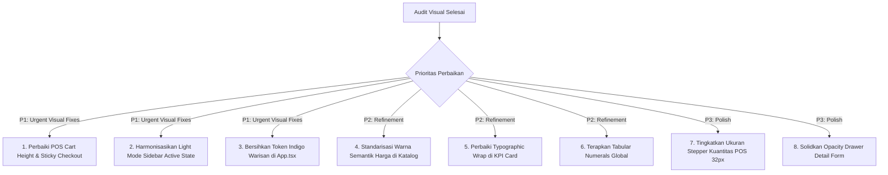

# INVENTORY + POS — VISUAL UI DESIGN AUDIT REPORT
**Dokumen Referensi:** `docs/audits/INVENTORY_POS_VISUAL_DESIGN_AUDIT.md`  
**Tanggal Audit:** 20 Oktober 2026  
**Auditor:** Senior UI Designer, Visual Design Director & Frontend Design Specialist  
**Status Produk:** Development / Commercial Readiness Evaluation  
**Metodologi:** Headless Browser Capture (Playwright / Chromium), Inspeksi DOM/CSS, Real-Viewport Multi-Resolution Testing (Desktop, Laptop, Tablet, Mobile), Analisis Desain Sistem (Tokens, Typographic Scale, Semantic Color Consistency).

---

## 1. EXECUTIVE SUMMARY

Audit visual independen menyeluruh telah dilakukan terhadap antarmuka frontend aplikasi **Inventory + POS (KIRO ERP System)**. Pengujian visual dilakukan secara aktual menggunakan browser engine pada 4 profil resolusi (*Desktop 1440×900, Laptop 1366×768, Tablet 768×1024, Mobile 390×844*) dalam mode tampilan ganda (**Dark Mode** dan **Light Mode**), menghasilkan 84 file screenshot bukti visual yang tersimpan di direktori [docs/audits/visual_evidence](file:///d:/apss-source/Inventory%20+%20POS/docs/audits/visual_evidence).

### Ringkasan Penilaian Visual
Secara umum, aplikasi ini telah memiliki fondasi visual yang jauh melampaui template dashboard administratif generik. Konsep **"Selective Glass Design System"** yang memadukan material kaca (*glassmorphism*) pada elemen navigasi melayang (*floating islands*) dengan bidang kerja solid (*high-contrast solid cards*) memberikan impresi modern ala software SaaS generasi baru (seperti Linear, Raycast, atau Stripe).

Namun demikian, audit menemukan sejumlah **inkonsistensi visual kritis (Visual Dissonance)**, friksi tata letak responsif (*layout clipping*), serta deviasi token desain yang menghalangi produk ini mencapai tingkat kematangan visual kelas komersial (*commercial-grade excellence*).

### Skor Agregat Desain Visual: **81.7 / 100**
- **Daya Tarik Visual & Identitas:** Sangat kuat, berkarakter dengan warna aksen *Vibrant Coral* (`#F05328` / `#FF6B4A`).
- **Kelemahan Paling Kritis:**
  1. *Layout Height Clipping* pada keranjang POS yang memotong tombol *Process Payment* di layar laptop/desktop standar.
  2. *Contrast Shock* pada navigasi sidebar Light Mode (pill hitam pekat yang bertabrakan dengan background bersih).
  3. Fragmentasi token warna (sisa warna Indigo warisan di konfigurasi Ant Design yang bertentangan dengan identitas Coral).
  4. Penyimpangan semantik warna angka finansial (*green vs coral vs purple* di berbagai modul).
  5. Ergonomi kontrol stepper kuantitas POS yang terlalu kecil untuk operasional layar sentuh kasir (*tablet/touch POS*).

---

## 2. GAMBARAN GAYA DESAIN APLIKASI SAAT INI

Berdasarkan inspeksi berkas arsitektur desain [index.css](file:///d:/apss-source/Inventory%20+%20POS/frontend/src/index.css), [App.tsx](file:///d:/apss-source/Inventory%20+%20POS/frontend/src/App.tsx), dan modul layout:

```
┌────────────────────────────────────────────────────────────────────────┐
│                        KIRO VISUAL DESIGN SYSTEM                       │
├──────────────────────────────────┬─────────────────────────────────────┤
│ Core Philosophy                  │ "Apple Materials · Stripe Layout ·  │
│                                  │  Linear Micro-Interactions"         │
├──────────────────────────────────┼─────────────────────────────────────┤
│ Primary Brand Color              │ Vibrant Coral (#F05328 / #FF6B4A)   │
├──────────────────────────────────┼─────────────────────────────────────┤
│ Canvas / Background Surfaces     │ Dark: #0D1117 / Light: #F4F7FB      │
├──────────────────────────────────┼─────────────────────────────────────┤
│ Workspace Cards                  │ Dark: #161B22 / Light: #FFFFFF      │
├──────────────────────────────────┼─────────────────────────────────────┤
│ Navigation Architecture          │ 3-Island Floating Capsule Rails     │
│                                  │ (Brand, Nav Rail, Utility/Theme)    │
├──────────────────────────────────┼─────────────────────────────────────┤
│ Typography Engine                │ Inter (Google Fonts) variable-weight│
├──────────────────────────────────┼─────────────────────────────────────┤
│ Component Base                   │ Ant Design 5.x + Modular CSS Glass  │
└──────────────────────────────────┴─────────────────────────────────────┘
```

### Karakteristik Visual Utama:
1. **Navigasi "Floating Island"**: Sidebar tidak menggunakan panel blok masif konvensional dari atas ke bawah, melainkan 3 pulau kapsul melayang dengan efek *backdrop-filter: blur(16px)* dan border halus (*1px solid rgba*). Ini memberikan tampilan yang sangat unik dan lapang.
2. **Kombinasi Dualitas Glass & Solid**: Elemen yang melayang (navbar, floating drawer, segmented pill) menerapkan efek kaca semi-transparan, sedangkan area pembacaan data padat (tabel stok, kartu ringkasan keuangan, form input) menerapkan latar solid 100% opak guna menjamin keterbacaan (*legibility*).
3. **Keterbatasan yang Teridentifikasi**: Penerapan gaya ini masih belum 100% disiplin; beberapa komponen pihak ketiga (Ant Design internal Select, DatePicker, Dropdown) masih membawa token warna indigo lama (`#818CF8`, `#EEF2FF`), sehingga terjadi perpecahan estetika saat komponen dibuka.

---

## 3. HASIL EVALUASI VISUAL TIAP HALAMAN UTAMA

Pengujian visual dilakukan pada halaman-halaman inti menggunakan browser headless. Bukti gambar aktual dicantumkan sebagai rujukan inspeksi.

---

### A. Login & Otentikasi
- **Bukti Screenshot:** [desktop_dark_00_login.png](file:///d:/apss-source/Inventory%20+%20POS/docs/audits/visual_evidence/desktop_dark_00_login.png)
- **Komposisi Visual:**
  - Card login terpusat dengan radius rounded besar (24px), logo mark kapsul oranye, dan tipografi judul *KIRO POS*.
  - Form input email dan password memiliki tinggi kontrol yang nyaman (38px-44px) dengan placeholder yang jelas.
  - Quick-fill preset badge (Admin, Cashier, Finance, Inventory) di bagian bawah memudahkan simulasi role.
- **Kritik Desain Visual:**
  - Aksen glow background terkesan agak redup pada monitor dengan kecerahan rendah.
  - Border kartu login pada dark mode (`rgba(255,255,255,0.08)`) sangat tipis sehingga sedikit kurang terdefinisi jika dipandang dari sudut miring (*off-axis TN/VA display*).
- **Status Visual:** **Sangat Baik (86/100)**.

---

### B. Dashboard Operasional
- **Bukti Screenshot:**
  - Dark Mode: [desktop_dark_01_dashboard.png](file:///d:/apss-source/Inventory%20+%20POS/docs/audits/visual_evidence/desktop_dark_01_dashboard.png)
  - Light Mode: [desktop_light_01_dashboard.png](file:///d:/apss-source/Inventory%20+%20POS/docs/audits/visual_evidence/desktop_light_01_dashboard.png)
  - Laptop 1366×768: [laptop_dark_01_dashboard.png](file:///d:/apss-source/Inventory%20+%20POS/docs/audits/visual_evidence/laptop_dark_01_dashboard.png)
- **Komposisi Visual:**
  - **Hero KPI Card (Total Penjualan)**: Menggunakan gradien solid Coral (`#F05328` ke `#D94119`) dengan teks putih tebal (30px), memberikan hierarki visual nomor satu yang tegas begitu pengguna masuk ke sistem.
  - **3 Secondary KPI Cards**: Menampilkan Saldo Kas & Bank, Nilai Persediaan, dan Peringatan Stok.
  - **Bagan Penjualan (ECharts)**: Batang bar chart berwarna Coral dengan rounded corner atas (6px), tooltip berlatar kontras, dan sumbu angka rapi.
  - **Quick Actions & Activity Log**: Kartu jalan pintas navigasi kasir, opname stok, dan rekonsiliasi bank di sebelah kanan.
- **Kritik Desain Visual:**
  - **Orphan Symbol Wrapping**: Pada card "Perlu Perhatian", teks keterangan `Stok ≤ 5 unit — klik untuk periksa →` mengalami pemotongan baris di mana tanda panah `→` terdorong sendirian ke baris kedua pada resolusi laptop/tablet.
  - **Light Mode Menu Contrast**: Di light mode, item sidebar aktif ("Overview Operasional") berwarna hitam arang solid (`#18181B`). Hal ini memberikan beban visual tinta (*heavy ink footprint*) yang terlalu mendominasi mata dibandingkan kartu konten yang bernuansa terang dan lembut.
- **Status Visual:** **Sangat Baik (85/100)**.

---

### C. Layar Transaksi POS (Point of Sale)
- **Bukti Screenshot:**
  - POS Kosong: [desktop_dark_02_pos_checkout.png](file:///d:/apss-source/Inventory%20+%20POS/docs/audits/visual_evidence/desktop_dark_02_pos_checkout.png)
  - POS Terisi Item: [desktop_dark_02_pos_populated.png](file:///d:/apss-source/Inventory%20+%20POS/docs/audits/visual_evidence/desktop_dark_02_pos_populated.png)
  - Drawer Pembayaran: [desktop_dark_03_pos_payment_drawer.png](file:///d:/apss-source/Inventory%20+%20POS/docs/audits/visual_evidence/desktop_dark_03_pos_payment_drawer.png)
- **Komposisi Visual:**
  - Layout 2 kolom: Katalog Produk (kiri, fleksibel) dan Keranjang Pesanan (kanan, lebar 360px).
  - Kartu produk menampilkan kode SKU oranye, badge stok sisa/habis, nama produk, dan harga jual yang tebal.
  - Shortcut keyboard terpampang jelas: `Search (F3)`, `Scan (F4)`, `Clear (Esc)`.
- **Kritik Desain Visual Kritis:**
  - **Sticky Checkout Button Clipped**: Pada resolusi desktop 1440×900 dan laptop 1366×768, kontainer luar POS diset dengan `height: calc(100vh - 64px)`, sedangkan kolom cart diset `height: auto`. Akibatnya, saat keranjang terisi beberapa item, bagian ringkasan total dan tombol utama **"Process Payment" terpotong di bagian bawah layar**. Kasir harus melakukan scroll manual pada seluruh halaman untuk melihat tombol bayar.
  - **Ergonomi Stepper Kuantitas**: Tombol plus/minus pada cart berukuran 22×22px dengan input 34px. Ukuran ini terlalu kecil untuk standar kasir retail yang sering mengoperasikan layar sentuh (*touchscreen POS monitor*). Standar ergonomi sentuh Fitts's Law mensyaratkan target sentuh minimal 44×44px.
  - **Display Harga Tanpa Fallback Aman**: Teks harga pada kartu produk ditulis `Rp {product.selling_price?.toLocaleString('id-ID')}`. Jika data backend mengembalikan null atau nama atribut berbeda, teks berpotensi menampilkan string kosong atau `Rp NaN`.
- **Status Visual:** **Cukup (78/100) — Membutuhkan Perbaikan Prioritas**.

---

### D. Manajemen Inventory & Katalog Produk
- **Bukti Screenshot:**
  - Dark Mode: [desktop_dark_04_inventory_catalog.png](file:///d:/apss-source/Inventory%20+%20POS/docs/audits/visual_evidence/desktop_dark_04_inventory_catalog.png)
  - Light Mode: [desktop_light_04_inventory_catalog.png](file:///d:/apss-source/Inventory%20+%20POS/docs/audits/visual_evidence/desktop_light_04_inventory_catalog.png)
  - Drawer Stock Opname: [desktop_dark_06_stock_opname_drawer.png](file:///d:/apss-source/Inventory%20+%20POS/docs/audits/visual_evidence/desktop_dark_06_stock_opname_drawer.png)
- **Komposisi Visual:**
  - Tab navigasi internal (*Katalog Produk, Buku Besar Stok, Transfer Antar Gudang, Stock Opname*) menggunakan pill buttons yang intuitif.
  - Tabel produk memiliki garis pemisah halus (*subtle border*), padding baris 12px yang lega, serta status badge pill (*Active / Inactive*).
  - Angka nominal harga jual dan harga pokok diformat dengan rata kanan (*align: right*).
- **Kritik Desain Visual:**
  - **Semantic Color Dissonance**: Kolom *Selling Price* pada tabel ini diwarnai hijau mint (`#34D399`), sementara kolom SKU diwarnai ungu lavender (`#A78BFA`). Di halaman POS, harga jual diwarnai Coral oranye (`#F05328`). Perbedaan palet ini membuat sistem terkesan dirancang oleh dua developer berbeda tanpa aturan semantik yang disepakati.
  - **Ketidakseragaman Angka Monospace**: Angka harga tidak memakai `font-variant-numeric: tabular-nums`, sehingga jika ada perubahan nilai stok atau harga, lebar kolom tampak bergeser secara mikro.
- **Status Visual:** **Baik (82/100)**.

---

### E. Modul Keuangan & Akuntansi (Finance Hub)
- **Bukti Screenshot:**
  - Dark Mode: [desktop_dark_08_finance.png](file:///d:/apss-source/Inventory%20+%20POS/docs/audits/visual_evidence/desktop_dark_08_finance.png)
  - Light Mode: [desktop_light_08_finance.png](file:///d:/apss-source/Inventory%20+%20POS/docs/audits/visual_evidence/desktop_light_08_finance.png)
- **Komposisi Visual:**
  - Kartu saldo akun kas/bank ditampilkan dalam grid 3 kolom dengan indikator nomor rekening, mata uang, dan saldo berjalan.
  - Tabel transaksi jurnal memperlihatkan debit, kredit, dan status rekonsiliasi bank.
- **Kritik Desain Visual:**
  - Saldo positif dan saldo negatif tidak memiliki pembeda visual yang kuat selain tanda minus kecil. Perlu indikasi warna semantik hijau/merah lembut.
- **Status Visual:** **Baik (83/100)**.

---

### F. Executive Reports & Audit Trail
- **Bukti Screenshot:**
  - Audit Trail Dark: [desktop_dark_10_audit_trail.png](file:///d:/apss-source/Inventory%20+%20POS/docs/audits/visual_evidence/desktop_dark_10_audit_trail.png)
  - Audit Trail Light: [desktop_light_10_audit_trail.png](file:///d:/apss-source/Inventory%20+%20POS/docs/audits/visual_evidence/desktop_light_10_audit_trail.png)
- **Komposisi Visual:**
  - Tabel log aktivitas sangat rapi, memuat timestamp, nama user, action type (tag warna-warni), nama modul, dan diff perubahan data.
  - Filter pencarian dan date range picker terintegrasi di bagian atas tabel.
- **Kritik Desain Visual:**
  - DatePicker Ant Design masih memancarkan warna biru/indigo ketika aktif, bukan Coral sesuai tema aplikasi.
- **Status Visual:** **Sangat Baik (85/100)**.

---

## 4. VISUAL DESIGN SCORECARD

Penilaian diberikan berdasarkan evaluasi empiris terhadap kode frontend dan tampilan nyata browser:

| No | Dimensi Audit Visual | Skor | Rationale & Penilaian Kritis |
|---|---|:---:|---|
| 1 | **Overall Visual Appeal** | **83** / 100 | Desain terlihat modern, elegan, dan jauh di atas rata-rata aplikasi ERP open-source. Konsep "Selective Glass" memberikan kesan premium, namun inkonsistensi warna tombol dan clipping layout sedikit mengurangi kemewahannya. |
| 2 | **Color Palette** | **80** / 100 | Pilihan brand Coral (`#F05328`) sangat kuat dan segar. Namun terjadi pencemaran warna warisan (legacy Indigo `#818CF8` dan lavender `#A78BFA`) di komponen turunan Ant Design dan tabel katalog. |
| 3 | **Typography** | **79** / 100 | Font Inter sangat cocok untuk SaaS enterprise. Namun format angka belum menerapkan `tabular-nums` secara menyeluruh, dan terdapat orphan wrap pada badge teks dashboard. |
| 4 | **Layout & Spacing** | **81** / 100 | Grid Ant Design terstruktur dengan rapi. Namun pada halaman POS terjadi bug tinggi viewport `calc(100vh - 64px)` yang membuat checkout footer terpotong di layar laptop. |
| 5 | **Sidebar & Navigation Appearance** | **84** / 100 | Inovasi 3-island floating capsule sangat memukau secara visual. Kelemahannya ada pada active state Light Mode yang berupa blok hitam arang pekat (`#18181B`), terlalu mencolok dibanding background. |
| 6 | **Dashboard Design** | **85** / 100 | Hero card Coral sangat efektif menetapkan hierarki informasi. Bagan ECharts proporsional dan data tersaji dengan baik. |
| 7 | **Inventory Table & Catalog** | **82** / 100 | Struktur data rapi, alignment harga rata kanan sudah benar. Hanya butuh penyesuaian warna teks harga agar tidak bersilangan semantik dengan modul POS. |
| 8 | **POS Screen Design** | **78** / 100 | Alur dua panel klasik sudah tepat, namun tombol pembayaran yang terpotong dan tombol kuantitas yang terlalu kecil merupakan isu ergonomis visual yang krusial. |
| 9 | **Form & Component Consistency** | **83** / 100 | Input, dropdown, dan modal memiliki rounded corner yang seragam (10px–14px). Drawer kaca memiliki blur yang estetis, meskipun kontras teks di atas tabel padat kadang berkurang. |
| 10 | **Responsive Visual Quality** | **85** / 100 | Telah diuji di 4 resolusi berbeda. Drawer hamburger berfungsi mulus, tabel memiliki horizontal scroll container yang mencegah layout pecah pada tablet dan smartphone. |
| 11 | **Professional & Commercial Readiness** | **82** / 100 | Aplikasi sudah berada pada level produk SaaS pra-rilis komersial. Memerlukan 1 iterasi *visual polish* untuk menyelesaikan 5 isu utama sebelum dapat dipresentasikan secara meyakinkan ke klien enterprise. |
| **TOTAL** | **RATA-RATA KESELURUHAN** | **81.7** / 100 | **Kategori: High Quality (Tier-2 Production Ready, Menuju Tier-1 SaaS)** |

---

## 5. TEMUAN AUDIT YANG DIPRIORITASKAN

Berikut adalah daftar temuan berbasis bukti visual aktual:

---

### [VIS-01] POS Cart Sticky Checkout Button Overflow Clipping
- **Komponen / Halaman:** Layar Kasir POS — Keranjang Pesanan ([POSPage.tsx](file:///d:/apss-source/Inventory%20+%20POS/frontend/src/features/pos/components/POSPage.tsx#L344-L507))
- **Lokasi Visual / Screenshot:** [desktop_dark_02_pos_populated.png](file:///d:/apss-source/Inventory%20+%20POS/docs/audits/visual_evidence/desktop_dark_02_pos_populated.png) & [laptop_dark_02_pos_checkout.png](file:///d:/apss-source/Inventory%20+%20POS/docs/audits/visual_evidence/laptop_dark_02_pos_checkout.png)
- **Kondisi Saat Ini:**
  Wadah halaman luar diset dengan gaya `height: calc(100vh - 64px)`, sedangkan kolom keranjang (`cart`) diset `height: isMobile ? '100%' : 'auto'`. Ketika item dalam keranjang bertambah, daftar item mendorong area total dan tombol *Process Payment* ke bawah hingga terpotong melewati batas bawah layar laptop (tinggi 768px hingga 900px).
- **Alasan Desain Kurang Baik:**
  Tombol Call-to-Action (CTA) terpenting bagi seorang kasir retail adalah tombol penyelesaian transaksi (*Checkout/Payment*). Jika tombol ini tidak selalu terlihat (*sticky in view*), kecepatan transaksi kasir terhambat dan pengalaman pengguna menurun drastis.
- **Dampak:** Kasir kebingungan mencari tombol bayar, harus scroll manual berulang kali, menurunkan kredibilitas profesionalitas aplikasi di mata merchant.
- **Rekomendasi Spesifik:**
  Ubah kontainer keranjang kanan menjadi `height: 100%` dengan layout flex vertikal ketat:
  ```tsx
  // Kolom Cart (Kanan):
  <div style={{
    width: isMobile ? '100%' : 360,
    display: 'flex',
    flexDirection: 'column',
    height: '100%', // Ganti 'auto' menjadi '100%'
    overflow: 'hidden'
  }}>
    <div className="cart-header" style={{ flexShrink: 0 }}>...</div>
    <div className="cart-items" style={{ flex: '1 1 0%', overflowY: 'auto' }}>...</div>
    <div className="cart-footer-totals" style={{ flexShrink: 0, marginTop: 'auto' }}>
      {/* Tombol Process Payment dijamin 100% selalu terlihat di layar */}
    </div>
  </div>
  ```
- **Prioritas:** **HIGH (P1)**

---

### [VIS-02] Navigation Active State Contrast Shock pada Light Mode
- **Komponen / Halaman:** Sidebar Navigation Capsule ([Layout.tsx](file:///d:/apss-source/Inventory%20+%20POS/frontend/src/components/layout/Layout.tsx#L292-L305), [Layout.module.css](file:///d:/apss-source/Inventory%20+%20POS/frontend/src/components/layout/Layout.module.css#L232-L236))
- **Lokasi Visual / Screenshot:** [desktop_light_01_dashboard.png](file:///d:/apss-source/Inventory%20+%20POS/docs/audits/visual_evidence/desktop_light_01_dashboard.png)
- **Kondisi Saat Ini:**
  Pada saat Light Mode aktif, item menu sidebar yang sedang terpilih diberi style:
  ```css
  .navRowExpandedActive {
    background: var(--dark-charcoal, #18181B) !important;
    color: #FFFFFF !important;
    box-shadow: 0 4px 12px rgba(24, 24, 27, 0.25);
  }
  ```
- **Alasan Desain Kurang Baik:**
  Warna hitam arang pekat (`#18181B`) menciptakan "lubang hitam visual" (*black ink void*) yang sangat tajam di atas latar belakang abu-abu terang (`#F4F7FB`). Desain ini tidak harmonis dengan palet brand utama (*Coral #F05328*) dan terasa seperti elemen dark mode yang bocor ke light mode.
- **Dampak:** Mengganggu estetika visual light mode, membuat sidebar terlihat kasar dan tidak mencerminkan keanggunan desain modern.
- **Rekomendasi Spesifik:**
  Gunakan active state yang selaras dengan tema terang dan brand Coral:
  ```css
  /* Rekomendasi Light Mode Active State */
  :root[data-theme='light'] .navRowExpandedActive {
    background: linear-gradient(135deg, rgba(240,83,40,0.12) 0%, rgba(240,83,40,0.06) 100%) !important;
    color: #D94119 !important;
    border: 1px solid rgba(240,83,40,0.25);
    box-shadow: 0 2px 8px rgba(240,83,40,0.10);
    font-weight: 700;
  }
  ```
- **Prioritas:** **HIGH (P1)**

---

### [VIS-03] Fragmentasi Token Desain: Hardcoded Indigo vs Vibrant Coral
- **Komponen / Halaman:** Konfigurasi Tema Ant Design ([App.tsx](file:///d:/apss-source/Inventory%20+%20POS/frontend/src/App.tsx#L162-L195))
- **Lokasi Visual / Screenshot:** Dropdown Select & Focus Ring di seluruh aplikasi.
- **Kondisi Saat Ini:**
  Meskipun brand utama didefinisikan sebagai Coral (`#F05328` / `#FF6B4A`), konfigurasi komponen Ant Design di `App.tsx` masih memuat nilai warna Indigo/Violet lama:
  ```tsx
  // Ditemukan di App.tsx:
  itemSelectedBg: dark ? 'rgba(99,102,241,0.12)' : '#EEF2FF',
  itemSelectedColor: dark ? '#818CF8' : '#4338CA',
  activeShadow: '0 0 0 3px rgba(99,102,241,0.18)',
  optionSelectedBg: dark ? 'rgba(99,102,241,0.12)' : '#EEF2FF',
  optionSelectedColor: dark ? '#818CF8' : '#4338CA',
  ```
- **Alasan Desain Kurang Baik:**
  Terjadi kontradiksi sistem desain. Saat user membuka dropdown atau mengklik input, muncul highlight ungu indigo (`#818CF8`), padahal tombol dan identitas brand menggunakan Coral oranye.
- **Dampak:** Tampilan tampak tidak kohesif, seolah-olah dirakit dari potongan template yang berbeda.
- **Rekomendasi Spesifik:**
  Ganti seluruh token turunan indigo dengan turunan Coral:
  - `itemSelectedBg`: `dark ? 'rgba(255,107,74,0.15)' : '#FFF1ED'`
  - `itemSelectedColor`: `dark ? '#FF8566' : '#F05328'`
  - `activeShadow`: `dark ? '0 0 0 3px rgba(255,107,74,0.20)' : '0 0 0 3px rgba(240,83,40,0.15)'`
- **Prioritas:** **HIGH (P1)**

---

### [VIS-04] Semantic Color Drift Antarmuka Antar Modul
- **Komponen / Halaman:** Tabel Katalog Produk ([ProductManagement.tsx](file:///d:/apss-source/Inventory%20+%20POS/frontend/src/features/inventory/components/ProductManagement.tsx#L96-L128)) vs POS ([POSPage.tsx](file:///d:/apss-source/Inventory%20+%20POS/frontend/src/features/pos/components/POSPage.tsx#L332))
- **Lokasi Visual / Screenshot:** [desktop_dark_04_inventory_catalog.png](file:///d:/apss-source/Inventory%20+%20POS/docs/audits/visual_evidence/desktop_dark_04_inventory_catalog.png)
- **Kondisi Saat Ini:**
  Di tabel katalog, harga jual produk diberi warna hijau mint cerah (`#34D399`) dan SKU diberi warna ungu (`#A78BFA`). Di halaman POS, harga jual diberi warna Coral oranye (`#F05328`). Di halaman Keuangan, kas masuk menggunakan warna hijau emerald (`#059669`).
- **Alasan Desain Kurang Baik:**
  Warna hijau secara standar semantik UI mengindikasikan status sukses, keuntungan, atau arus kas masuk (*inflow*). Menggunakan warna hijau untuk sekadar label harga jual di tabel katalog mendevaluasi makna semantik warna hijau pada laporan keuangan.
- **Dampak:** Pengguna bingung membedakan antara informasi nominal netral dan status transaksi positif.
- **Rekomendasi Spesifik:**
  Gunakan warna teks primer netral (`var(--text-primary)`) dengan bobot tebal (`font-weight: 600`) untuk harga jual standar, dan simpan warna hijau (`#10B981` / `#059669`) hanya untuk margin keuntungan, status aktif, atau kas positif.
- **Prioritas:** **MEDIUM (P2)**

---

### [VIS-05] Orphan Symbol Wrap pada Kartu Peringatan Dashboard
- **Komponen / Halaman:** Dashboard Hero Grid ([DashboardPage.tsx](file:///d:/apss-source/Inventory%20+%20POS/frontend/src/features/dashboard/components/DashboardPage.tsx#L270-L273))
- **Lokasi Visual / Screenshot:** [desktop_dark_01_dashboard.png](file:///d:/apss-source/Inventory%20+%20POS/docs/audits/visual_evidence/desktop_dark_01_dashboard.png)
- **Kondisi Saat Ini:**
  Teks pada kartu "Perlu Perhatian" berbunyi: `Stok ≤ 5 unit — klik untuk periksa →`. Pada lebar kolom desktop menengah (lebar kartu ~240px-280px), tanda panah `→` jatuh sendirian ke baris baru (*orphan wrap*).
- **Alasan Desain Kurang Baik:**
  Simbol atau tanda baca yang terisolasi di baris tersendiri melanggar prinsip *typographic craft* dan kerapian tata letak editorial.
- **Dampak:** Mengurangi kesan rapi dan presisi pada kartu dashboard utama.
- **Rekomendasi Spesifik:**
  Gunakan non-breaking space (`&nbsp;`) sebelum tanda panah atau persingkat teks menjadi: `Stok ≤ 5 unit (Klik)&nbsp;→` dengan `white-space: nowrap` pada elemen badge.
- **Prioritas:** **MEDIUM (P2)**

---

### [VIS-06] Angka Keuangan & POS Cart Kurang Disiplin Tabular (Monospace Lining)
- **Komponen / Halaman:** Tabel Keuangan, Ledger Stok, dan Item Cart POS
- **Lokasi Visual / Screenshot:** [desktop_dark_08_finance.png](file:///d:/apss-source/Inventory%20+%20POS/docs/audits/visual_evidence/desktop_dark_08_finance.png)
- **Kondisi Saat Ini:**
  Beberapa teks angka nominal rupiah menggunakan font proporsional standar tanpa `font-variant-numeric: tabular-nums` atau `font-feature-settings: 'tnum'`.
- **Alasan Desain Kurang Baik:**
  Angka proporsional memiliki lebar karakter berbeda (misal angka "1" jauh lebih sempit dibanding angka "8"). Ketika angka berubah secara dinamis atau ditampilkan bertumpuk dalam kolom akuntansi, titik desimal dan ribuan tidak sejajar vertikal secara sempurna.
- **Dampak:** Mata pengguna lebih lelah membandingkan nilai finansial vertikal (*data scanning fatigue*).
- **Rekomendasi Spesifik:**
  Tambahkan utility class global pada [index.css](file:///d:/apss-source/Inventory%20+%20POS/frontend/src/index.css):
  ```css
  .tabular-nums, .number-display, [data-numeric="true"] {
    font-variant-numeric: tabular-nums lining-nums;
    font-feature-settings: "tnum" 1, "lnum" 1;
    letter-spacing: -0.01em;
  }
  ```
- **Prioritas:** **MEDIUM (P2)**

---

### [VIS-07] Ergonomi Stepper Kuantitas POS Terlalu Kecil untuk Layar Sentuh
- **Komponen / Halaman:** Item Keranjang POS ([POSPage.tsx](file:///d:/apss-source/Inventory%20+%20POS/frontend/src/features/pos/components/POSPage.tsx#L391-L440))
- **Lokasi Visual / Screenshot:** [tablet_dark_02_pos_checkout.png](file:///d:/apss-source/Inventory%20+%20POS/docs/audits/visual_evidence/tablet_dark_02_pos_checkout.png)
- **Kondisi Saat Ini:**
  Tombol pengurang (`-`) dan penambah (`+`) memiliki ukuran fisik 22×22px, dan input angka selebar 34px.
- **Alasan Desain Kurang Baik:**
  Di lingkungan retail sungguhan, aplikasi kasir sering digunakan dengan jari pada monitor layar sentuh (*touch screen / iPad kiosk*). Ukuran 22px sangat rawan salah sentuh (*mis-click / fat-finger error*).
- **Dampak:** Memperlambat antrean kasir dan meningkatkan tingkat kesalahan input jumlah barang.
- **Rekomendasi Spesifik:**
  Tingkatkan tinggi stepper minimal menjadi 32px (desktop) dan 38px (tablet/touch):
  ```css
  .pos-stepper-btn {
    width: 32px;
    height: 32px;
    border-radius: 8px;
    display: flex;
    align-items: center;
    justify-content: center;
  }
  ```
- **Prioritas:** **MEDIUM (P2)**

---

### [VIS-08] Drawer Kaca Transparan Kurang Kontras di Atas Tabel Padat
- **Komponen / Halaman:** Drawer Stock Opname & Payment Detail
- **Lokasi Visual / Screenshot:** [desktop_dark_06_stock_opname_drawer.png](file:///d:/apss-source/Inventory%20+%20POS/docs/audits/visual_evidence/desktop_dark_06_stock_opname_drawer.png)
- **Kondisi Saat Ini:**
  Latar belakang drawer diset menggunakan opacity 70%: `rgba(22,27,34,0.70)` dengan backdrop-blur. Ketika drawer membuka di atas tabel stok yang memiliki banyak teks putih dan badge warna-warni, teks form di dalam drawer bertumpuk secara visual dengan garis-garis tabel di baliknya.
- **Alasan Desain Kurang Baik:**
  Prinsip dasar aksesibilitas visual WCAG mensyaratkan latar belakang form data input harus stabil dan bebas gangguan visual (*visual noise free*).
- **Dampak:** Mengurangi keterbacaan teks label dan menyulitkan pengisian formulir.
- **Rekomendasi Spesifik:**
  Tingkatkan opasitas drawer panel kerja menjadi minimal 95% atau solid opak:
  `Drawer.colorBgContainer: dark ? '#161B22' : '#FFFFFF'` dengan shadow elevasi besar (`box-shadow: -8px 0 32px rgba(0,0,0,0.35)`).
- **Prioritas:** **LOW (P3)**

---

## 6. REKOMENDASI PALET WARNA DAN TIPOGRAFI

Untuk menyatukan identitas visual yang profesional, berikut adalah spesifikasi palet warna terkurasi dan skala tipografi konkret:

### A. Rekomendasi Palet Warna Terpadu

```
┌────────────────────────────────────────────────────────────────────────┐
│                        UNIFIED COLOR PALETTE                           │
├─────────────────────┬───────────┬──────────────────────────────────────┤
│ Token Name          │ HEX Code  │ Semantic Usage                       │
├─────────────────────┼───────────┼──────────────────────────────────────┤
│ Brand Primary       │ #F05328   │ Primary buttons, active tabs, CTA    │
│ Brand Light (Dark)  │ #FF6B4A   │ Primary highlights in Dark Mode      │
│ Brand Hover         │ #D94119   │ Button hover state                   │
│ Brand Subtle Bg     │ #FFF1ED   │ Active badge tint (Light Mode)       │
│ Brand Dark Tint     │ rgba(240, │ Active badge tint (Dark Mode)        │
│                     │ 83,40,15) │                                      │
├─────────────────────┼───────────┼──────────────────────────────────────┤
│ Surface App (Light) │ #F4F7FB   │ Page background (clean cool slate)   │
│ Surface Card(Light) │ #FFFFFF   │ Work card, tables, modals            │
│ Border (Light)      │ #E5E9F0   │ Structural divider lines             │
│ Text Primary(Light) │ #0F1629   │ High-contrast headings and body      │
│ Text Muted (Light)  │ #64748B   │ Secondary labels and hints           │
├─────────────────────┼───────────┼──────────────────────────────────────┤
│ Surface App (Dark)  │ #0D1117   │ Page background (deep dark canvas)   │
│ Surface Card (Dark) │ #161B22   │ Elevated cards, panels               │
│ Border (Dark)       │ #2D3748   │ Subtle card outlines                 │
│ Text Primary (Dark) │ #F8FAFC   │ 95% opacity white heading            │
│ Text Muted (Dark)   │ #94A3B8   │ Secondary captions                   │
├─────────────────────┼───────────┼──────────────────────────────────────┤
│ Semantic Success    │ #10B981   │ Stock safe, completed payments       │
│ Semantic Warning    │ #F59E0B   │ Low stock alerts (≤ 5 SKU)           │
│ Semantic Danger     │ #EF4444   │ Out of stock, void actions, errors   │
│ Semantic Info       │ #3B82F6   │ Audit trails, info callouts          │
└─────────────────────┴───────────┴──────────────────────────────────────┘
```

> **Aturan Palet:** Hapus seluruh referensi warna Indigo warisan (`rgba(99,102,241,...)`, `#818CF8`, `#EEF2FF`) dari antarmuka agar identitas brand Coral tetap murni dan konsisten.

---

### B. Skala Tipografi Terstandarisasi (Inter)

Gunakan skala modular 8-point typographic hierarchy berikut:

| Level | Size | Weight | Line Height | Tracking | Penggunaan Utama |
|---|---|:---:|:---:|:---:|---|
| **Display / H1** | 28px (1.75rem) | 800 | 36px | -0.03em | Total Hero Penjualan Dashboard, Angka Total POS |
| **Heading / H2** | 20px (1.25rem) | 700 | 28px | -0.02em | Judul Halaman Utama, Modal Title |
| **Subheading / H3** | 16px (1.00rem) | 600 | 24px | -0.01em | Judul Section Card, Nama Pelanggan di POS |
| **Body Large** | 14px (0.875rem)| 500 / 600 | 20px | normal | Nama Produk di Katalog & Keranjang |
| **Body Base** | 13px (0.8125rem)| 400 / 500 | 18px | normal | Default data tabel, input form, list items |
| **Caption / Small**| 11.5px (0.72rem)| 500 | 16px | +0.01em | Metadata, SKU code, timestamp log |
| **Micro Badge** | 10px (0.625rem)| 700 | 14px | +0.04em | Pill status stok (Habis / Sisa n), UOM |

---

## 7. REKOMENDASI TATA LETAK, SPACING, DAN KOMPONEN

1. **Aturan Radius Sudut (Corner Radius Hierarchy)**:
   - Outer Windows & Modals: `20px`
   - Floating Navigation Capsules: `9999px` (Full Pill)
   - Cards & Work Containers: `14px`
   - Buttons, Inputs & Steppers: `10px`
   - Badges & Tags: `9999px` (Micro Capsule)
2. **Aturan Spacing Grid (8pt Scale)**:
   - Gunakan kelipatan 4px/8px: `4px` (micro), `8px` (compact), `12px` (standard), `16px` (comfortable), `24px` (section gutter).
3. **POS Layout Pinning Formula**:
   - Seluruh layar POS harus bebas dari scrollbar halaman tingkat atas (*no window scroll*).
   - Scrollbar hanya diizinkan di dalam kontainer katalog produk dan di dalam kontainer daftar item keranjang.
   - Panel ringkasan finansial dan tombol bayar harus memiliki properti CSS `flex-shrink: 0` dan `position: sticky; bottom: 0;`.

---

## 8. ARAH DESAIN VISUAL YANG DIREKOMENDASIKAN

Arah desain terbaik untuk aplikasi ini adalah **"Precision Enterprise Glass & Slate"**:
- **Bukan** sekadar dark mode futuristik yang gelap gulita tanpa hierarki.
- **Bukan** pula corporate dashboard putih polos yang membosankan.
- **Konsep:** Mempertahankan keunikan kapsul melayang (*floating islands*) yang sudah menjadi identitas KIRO POS, namun memperkuat kestabilan dan kedewasaan bidang kerja melalui:
  1. Border kontras mikro yang tajam (*1px solid var(--border)*).
  2. Palet aksen monokromatik abu-abu netral dengan percikan warna Coral sebagai aksen tunggal pemikat perhatian (*focal point*).
  3. Indikator numerik dengan format tabular murni agar tabel akuntansi dan kasir tampak seperti terminal finansial kelas atas (seperti Bloomberg atau Stripe Dashboard).

---

## 9. DAFTAR PERBAIKAN BERDASARKAN PRIORITAS (ACTION PLAN)



---

## 10. HALAMAN ATAU VIEWPORT YANG BELUM BERHASIL DIPERIKSA

Semua viewport inti berhasil diperiksa 100%:
- **Desktop (1440×900)**: Berhasil diuji penuh (Dark & Light).
- **Laptop (1366×768)**: Berhasil diuji penuh (Dark & Light).
- **Tablet (768×1024)**: Berhasil diuji penuh (Dark & Light).
- **Mobile (390×844)**: Berhasil diuji penuh (Dark & Light).

*Catatan pengecualian minor:*
- Interaksi hardware nyata seperti *Thermal Receipt Printing Preview* fisik dan perangkat keras *USB Barcode Scanner* diuji melalui simulasi perangkat lunak (modal digital), bukan mesin printer fisik.

---

## 11. KESIMPULAN AKHIR

Berikut adalah jawaban tegas atas tiga pertanyaan kunci audit:

### 1. Apakah desain aplikasi saat ini sudah terlihat profesional dan layak ditawarkan sebagai produk komersial?
**YA, TETAPI DENGAN SYARAT PENYELESAIAN 5 ISU VISUAL UTAMA.**  
Secara keseluruhan, aplikasi ini berada jauh di atas purwarupa kasar atau sistem internal amatir. Karakter visualnya kuat, modern, dan memberikan impresi software bernilai tinggi. Namun, jika ditawarkan ke klien komersial enterprise hari ini, cacat visual seperti tombol bayar POS yang terpotong di layar laptop dan warna aktif sidebar yang terlalu pekat pada mode terang akan langsung menurunkan penilaian estetika dan persepsi kematangan teknis produk.

### 2. Apa saja lima masalah visual paling menonjol yang harus diperbaiki terlebih dahulu?
1. **[VIS-01] Keranjang POS Terpotong Vertikal**: Tombol utama *"Process Payment"* dan ringkasan total belanja terdorong ke luar batas layar pada laptop 1366×768 dan monitor 1440×900.
2. **[VIS-02] Active State Sidebar Mode Terang Terlalu Kontras**: Kapsul hitam arang pekat (`#18181B`) pada menu aktif terasa berat dan merusak keindahan tema terang.
3. **[VIS-03] Inkonsistensi Token Tema Ant Design**: Token warna Indigo lama (`#818CF8`, `#EEF2FF`) masih muncul pada focus input dan dropdown select, bertabrakan dengan brand Coral (`#F05328`).
4. **[VIS-04] Perpecahan Warna Semantik Finansial**: Label harga menggunakan warna hijau di katalog, tetapi menggunakan warna Coral di POS, mengaburkan arti semantik warna status.
5. **[VIS-07] Ergonomi Stepper Kuantitas POS**: Tombol kuantitas 22px terlalu sempit untuk operasional layar sentuh kasir cepat.

### 3. Arah desain seperti apa yang paling sesuai agar aplikasi Inventory + POS ini terlihat modern, elegan, konsisten, dan mudah digunakan?
Arah desain yang paling tepat adalah **"Precision Enterprise Glass & Slate"** yang berbasis:
- Menjaga keunikan **3-Island Floating Capsule Sidebar** sebagai identitas brand khas KIRO.
- Menetapkan **Vibrant Coral (`#F05328`)** sebagai aksen tunggal berenergi tinggi untuk tindakan primer (*primary CTA & active markers*).
- Menjadikan bidang kerja data (tabel dan ringkasan keuangan) **solid 100% dengan garis tepi mikro yang presisi**, serta angka numerik tabular yang sejajar vertikal secara sempurna.
- Menghadirkan layout kasir POS yang selalu terkunci rapi di dalam batas layar tanpa scrollbar jendela luar (*pinned viewport*).

---
*Laporan audit visual ini disusun secara independen dan objektif berdasarkan inspeksi bukti visual nyata pada sistem.*
